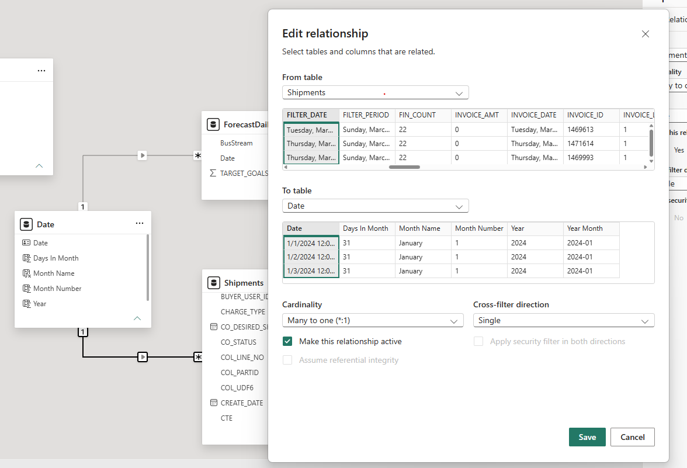

# shipment transformations
## Sales Report 

```
= Table.TransformColumns(Source,{{"ORDER_DATE", DateTime.Date, type date}, {"CREATE_DATE", DateTime.Date, type date}, {"DESIRED_SHIP_DATE", DateTime.Date, type date}, {"FILTER_DATE", DateTime.Date, type date}, {"SHIPPED_DATE", DateTime.Date, type date}, {"INVOICE_DATE", DateTime.Date, type date}, {"FILTER_PERIOD", DateTime.Date, type date}, {"ADJUSTED_DUE_DATE", DateTime.Date, type date}})
```

``` 
 Table.AddColumn(#"Extracted Date", "BusinessStream2", each if [BUS_STREAM] = "CMP-FIN" then 1 else if [BUS_STREAM] = "CMP-MFG" then 2 else [BUS_STREAM])

 ```

```
=Table.AddColumn(#"BusinessStream2", "TotalShipped", each [TOTAL_SHIPPED_QTY]*[UNIT_PRICE])
```

