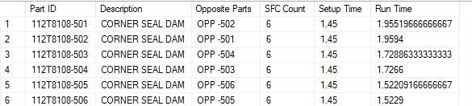

## Custom and Unlinked - Guide

See - Corpus - Routing


This guide is created to provide accurate descriptions within process flows to 
create meaningful data that is interpreted corectly.

Note that some of the ordering processes in the area of unlinked and/or custom order fulfillmemt
is often very localized and can contain terminology that is more difficult to integrate.

It may be more concise to put the order flow before the shipper flow and use WHERE SL.SHIPPED_QTY > 0.
In reporting queries sometimes the shipper flow will precede order flow, but the stock on hand may be
elevated in importance to show shipment that is not released.

For billing queries as example, you may only want to elevate shippeds orders in importance.

# Example = Customer X
Customer X's orders are linked, but the order control is customized. The fee structure is agreed-upon.

# Task Request - Join Customer X Billing to Core Shipments Feed by internal Order ID

We bill Customer X for different product types, and for CMP,
Different charges asessed differemtly, but based on hours.
But the hours may be baselined also, by prroduct type, part.

*   [5AXIS](/C:/Users/williamt/source/skillsinc/skills-inc-org/SQL-Projects/Documentation/Schema/Data_Models/Customer_Order/Custom_Unlinked_Billing/003 Custom Orders Charged by Rate - Explainer 001.md)
*   [ASSY](/C:/Users/williamt/source/skillsinc/skills-inc-org/SQL-Projects/Documentation/Schema/Data_Models/Customer_Order/Custom_Unlinked_Billing/BOE_BILLING_ASSY_Explainer.md)
*   [EME](/C:/Users/williamt/source/skillsinc/skills-inc-org/SQL-Projects/Documentation/Schema/Data_Models/Customer_Order/Custom_Unlinked_Billing/BOE_BILLING_EME.sql)
*   [FINISH](/C:/Users/williamt/source/skillsinc/skills-inc-org/SQL-Projects/Documentation/Schema/Data_Models/Customer_Order/Custom_Unlinked_Billing/BOE_BILLING_FINISH.sql)
*   [MFG](/C:/Users/williamt/source/skillsinc/skills-inc-org/SQL-Projects/Documentation/Schema/Data_Models/Customer_Order/Custom_Unlinked_Billing/BOE_BILLING_MFG.sql)

# Task Request - Problems
Customer X's billing queries and reports are customized.
  - the best example is RAMAC, which is an approximation of order identifier
  - we need to have Order ID and line number placed in the migration that joins Customer x to the core shipments (sales) flow.

**Problem Focus 1:**  Row enforement

  - Each internal order is assumed to be composed of one order ID, and one Line number
  - The previous report developer did not enforce this rule
  - Each query stood on its own granularity using RAMAC, and the developer grouped on customer x fields.

# Gross Margin SQL Agent Job - ```Gross Margin```
Server: sql-bi-1
Data base: DataMart
EXEC usp_Gross_Margin
GM Report has bus_unit
```sql
select gm.bus_UNIT,gm.* from datawarehouse.dbo.gross_margin gm (nolock) where bus_UNIT = 'cmp-fin' ORDER BY gm.bus_UNIT ```


X = on disk
## Customer X
We bill Customer X for different product types, and for CMP,
Different charges asessed differemtly, but based on hours.
But the hours may be baselined also, by prroduct type, part.

*   [5AXIS](/C:/Users/williamt/source/skillsinc/skills-inc-org/SQL-Projects/Documentation/Schema/Data_Models/Customer_Order/Custom_Unlinked_Billing/003 Custom Orders Charged by Rate - Explainer 001.md)
*   [ASSY](/C:/Users/williamt/source/skillsinc/skills-inc-org/SQL-Projects/Documentation/Schema/Data_Models/Customer_Order/Custom_Unlinked_Billing/BOE_BILLING_ASSY_Explainer.md)
*   [EME](/C:/Users/williamt/source/skillsinc/skills-inc-org/SQL-Projects/Documentation/Schema/Data_Models/Customer_Order/Custom_Unlinked_Billing/BOE_BILLING_EME.sql)
*   [FINISH](/C:/Users/williamt/source/skillsinc/skills-inc-org/SQL-Projects/Documentation/Schema/Data_Models/Customer_Order/Custom_Unlinked_Billing/BOE_BILLING_FINISH.sql)
*   [MFG](/C:/Users/williamt/source/skillsinc/skills-inc-org/SQL-Projects/Documentation/Schema/Data_Models/Customer_Order/Custom_Unlinked_Billing/BOE_BILLING_MFG.sql)

## 5AXIS
Hourly charge, and hours are fixed to schedule
[SQL-BI-1].LIVESupplemental.dbo.[BOE_Billing_5AXIS]

## ASSY (Assembly Billing)
The Assembly billing report calculates dynamic pricing based on actual hours booked by personnel via labor tickets on related assembly work orders.
For a detailed analysis of its table joints, formulas, exclusions, and multi-query cross-join granularity risks, see:
*   [BOE_BILLING_ASSY_Explainer.md](/C:/Users/williamt/source/skillsinc/skills-inc-org/SQL-Projects/Documentation/Schema/Data_Models/Customer_Order/Custom_Unlinked_Billing/BOE_BILLING_ASSY_Explainer.md)

## Schedule - BOE_Billing_5AXIS
Columns:
- Part ID
- Description
- Opposite Parts
- SFC Count
- Setup Time
- Run Time



