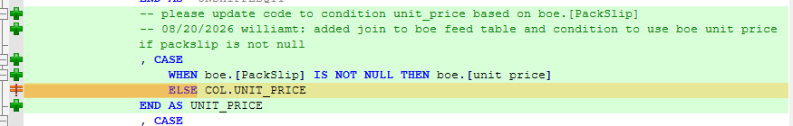

update shipment $ for boe billing
update SP_SK_ETL02_CUST_SHIP

## Shipments Core Feed 1

```sql
SELECT * FROM LIVESupplemental.dbo.PBI_Customer_Shipments_complement 
WHERE FILTER_DATE >= '2025-01-01'
```


## BOE Billing Core Feed 2

```sql
Select top 10 
   PackSlip, [unit price], [extended dollars], [expedite dollars], [special fees], [setup hours], [run hours], [expedite hours], [pack slips / date], [invoice id], [comments]
FROM LIVESupplemental.dbo.Feed_02_Core_BOE_Billing
```




-- C:\Users\williamt\OneDrive - Skills Inc GCC High\Documents\sql\20260815 Luke - Sales Forecast II\zb20260818 Add CMP Amount\Gross Margin Demo.sql
-- and
-- C:\Users\williamt\source\skillsinc\skills-inc-org\SQL-Projects\Documentation\Schema\Data_Models\Customer_Order\Shipping\sp_BOE_Billing_Core_Feed_01.sql

can have duplicate packslips across custom billed products


