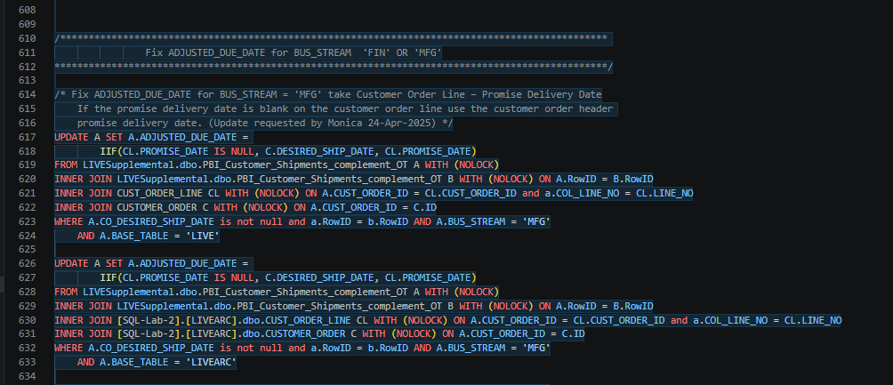

## Problem: Code for SP_SK_ETL03_CUST_SHIP in SP_SK_ETL01_CUST_SHIP 

Problem: Code for SP_SK_ETL03_CUST_SHIP was placed in procedure SP_SK_ETL01_CUST_SHIP test file Documentation\Schema\Data_Models\Customer_Order\Shipping\zza_SP_SK_ETL01_CUST_SHIP.sql

See Documentation\Schema\Data_Models\Customer_Order\Shipping\zza_SP_SK_ETL01_CUST_SHIP.sql 
procedure SP_SK_ETL01_CUST_SHIP lines 609 - 699.

make a comprison to SP_SK_ETL03_CUST_SHIP in test file Documentation\Schema\Data_Models\Customer_Order\Shipping\zza_SP_SK_ETL03_CUST_SHIP.sql




```sql
/******************************************************************************************************/
/****   Take data from PBI_Customer_Shipments_complement and create data for On Time Delivery   *******/
/******************************************************************************************************/


/* Data for new Table LIVESupplemental.dbo.PBI_Customer_Shipments_complement_OT to calculate OnTime Delivery */
TRUNCATE TABLE  LIVESupplemental.dbo.PBI_Customer_Shipments_complement_OT

INSERT INTO LIVESupplemental.dbo.PBI_Customer_Shipments_complement_OT

SELECT A.*, CL.USER_6, 'LIVE' FROM LIVESupplemental.dbo.PBI_Customer_Shipments_complement A WITH (NOLOCK)
LEFT JOIN LIVE.dbo.CUST_ORDER_LINE CL WITH (NOLOCK) ON A.CUST_ORDER_ID = CL.CUST_ORDER_ID 
	AND A.COL_LINE_NO = CL.LINE_NO
WHERE A.FILTER_DATE >= '2024-12-24' --and a.CUST_ORDER_ID = '498033' order by a.COL_LINE_NO
--	UNION
--SELECT A.*, CL.USER_6, 'LIVEARC' FROM [SQL-Bi-1].LIVESupplemental.dbo.PBI_Customer_Shipments_ARC A WITH (NOLOCK)
--LEFT JOIN [SQL-Lab-2].[LIVEARC].dbo.CUST_ORDER_LINE CL WITH (NOLOCK) ON A.CUST_ORDER_ID = CL.CUST_ORDER_ID 
--	AND A.COL_LINE_NO = CL.LINE_NO
--WHERE FILTER_DATE >= '2024-01-01' and FILTER_DATE < '2024-12-25' --and a.CUST_ORDER_ID = '498033'

--select USER_6, USER_10, * from [SQL-Lab-2].[LIVEARC].dbo.CUST_ORDER_LINE where USER_10 = 'CBO' and user_6 != user_10
--select USER_6, USER_10, * from [LIVE].dbo.CUST_ORDER_LINE where USER_6 = 'CBO' and user_6 != user_10

UPDATE A SET A.ADJUSTED_DUE_DATE = C.DESIRED_SHIP_DATE
FROM LIVESupplemental.dbo.PBI_Customer_Shipments_complement_OT A WITH (NOLOCK)
INNER JOIN CUSTOMER_ORDER C ON A.CUST_ORDER_ID = C.ID
WHERE A.ADJUSTED_DUE_DATE IS NULL
UPDATE A SET A.CO_DESIRED_SHIP_DATE = C.DESIRED_SHIP_DATE
-- -- ~22 break-fix 7/31/26 wlliamt
--          ||
-- line 546 vv
-- select *
FROM LIVESupplemental.dbo.PBI_Customer_Shipments_complement_OT A WITH (NOLOCK)
INNER JOIN CUSTOMER_ORDER C ON A.CUST_ORDER_ID = C.ID
WHERE A.CO_DESIRED_SHIP_DATE IS NULL   -- AND BASE_TABLE = 'LIVE' --AND A.BUS_STREAM IN ('CMP-FIN', 'CMP-MFG')
-- ~22 break-fix 7/31/26 wlliamt
--UPDATE A SET A.CO_DESIRED_SHIP_DATE = C.DESIRED_SHIP_DATE
--FROM LIVESupplemental.dbo.PBI_Customer_Shipments_complement_OT A WITH (NOLOCK)
--INNER JOIN [SQL-Lab-2].[LIVEARC].dbo.CUSTOMER_ORDER C ON A.CUST_ORDER_ID = C.ID
--WHERE A.CO_DESIRED_SHIP_DATE IS NULL AND BASE_TABLE = 'LIVEARC' --AND A.BUS_STREAM IN ('CMP-FIN', 'CMP-MFG')


/*	update ADJUSTED_DUE_DATE for  'CMP-FIN' and 'CMP-MFG'	*/ 
UPDATE A SET A.ADJUSTED_DUE_DATE = IIF(A.DESIRED_RLS_DATE IS NULL, A.CO_DESIRED_SHIP_DATE,
	CONVERT(varchar(12), DATEADD(DAY, 10, A.DESIRED_RLS_DATE), 23) )
FROM LIVESupplemental.dbo.PBI_Customer_Shipments_complement_OT A WITH (NOLOCK)
--INNER JOIN LIVESupplemental.dbo.PBI_Customer_Shipments_complement_OT B WITH (NOLOCK) ON A.RowID = B.RowID
WHERE --A.RowID = B.RowID AND 
A.BUS_STREAM = 'CMP-FIN'

UPDATE A SET A.ADJUSTED_DUE_DATE = IIF(A.DESIRED_RLS_DATE IS NULL, A.CO_DESIRED_SHIP_DATE,
	CONVERT(varchar(12), DATEADD(DAY, 30, A.DESIRED_RLS_DATE), 23) )
FROM LIVESupplemental.dbo.PBI_Customer_Shipments_complement_OT A WITH (NOLOCK)
--INNER JOIN LIVESupplemental.dbo.PBI_Customer_Shipments_complement_OT B WITH (NOLOCK) ON A.RowID = B.RowID
WHERE --A.RowID = B.RowID AND 
A.BUS_STREAM = 'CMP-MFG'
```