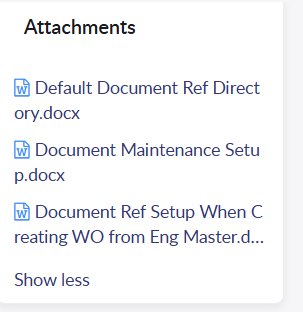

# KB1110312

## How to set up Document References

**(see attachments with screen captures)**

Article Information
________________________________________________________________________________________________________________

Description :

How to set up document references.

## Resolution :
All Document References in VISUAL start in Document Maintenance.  First set up a “Document Id” for the document and select a location where this document can be found.  Most likely there will be a central file storage area for all company documentation, drawings, specification sheets, etc.  In Document Maintenance, set up the document Id, path to the document, revision, reference type, and document category.

If certain documentation is to “follow” a part, assign a document to a part id.  This is where the user would choose the documents to be attached to the part id.

**(see attachments with screen captures)**

(Document Maintenance Setup.docx)

(Document Ref Setup When Creating WO from Eng Master.docx)

(Default Document Ref Directory.docx)

