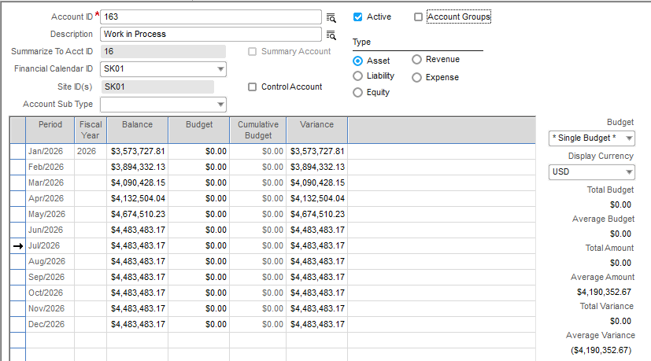
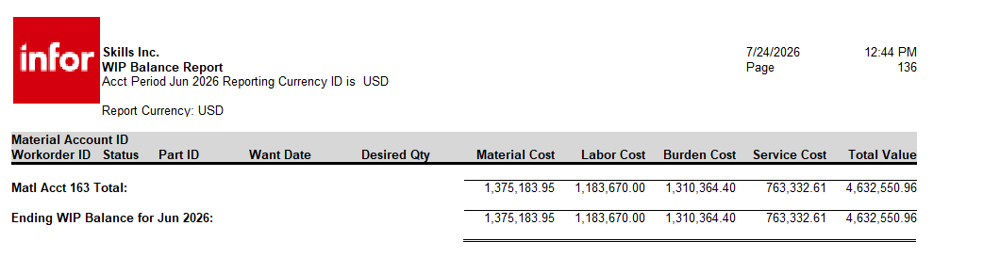

KB0732933
-- A7

CS0974181
-- a4
KB2063761
--a5
KB0731106
--a6
KB0732933
--a7
KB0741073
--a8
KB1543275
--a9

## How to reconcile Work In Process (WIP) to Ledger.

Description :

How to reconcile Work In Process (WIP) to Ledger.

Before beginning, ensure all transactions are entered and posted.

Print the WIP Balance Report:  Ledger > Post Manufacturing Journals > Reports > WIP Balances.

**This should match to the balance in the Accounting Window for the WIP account.**

 If it does not, follow these steps:

1.  In Ledger > Accounting Window, pull up the WIP account.  Drill into the period and ensure the only Type batches are WIP (Work In Process) and FG (Finished Goods).   If there are other batch types, these should be reversed using a General Journal Entry.  Refer to related KB0732063 for additional details on obtaining a GJ total.

2.  Verify that there are no 0.00 batches.  These batches may not have posted correctly due to changing screens or other disturbances while posting and would create a batch for zero dollars.  To find $0 batches, go to Ledger > General Journal Entry > Edit > View Batch Information and browse batch ID's by posting date.  If the amount is $0.00, pull them into the window.  If there are no details to the batch, the batch needs to be deleted and reposted. Reference related KB1015071.  

3.  Verify there are no exceptions.  Reference related KB0741317.

4.  Any invoices that are not posted because of an error in the date can be found by running the following SQL statement:

SELECT * FROM WIP_ISSUE_DIST WHERE POSTING_STATUS = 'U'

SELECT * FROM WIP_RECEIPT_DIST WHERE POSTING_STATUS = 'U'

Any future dated transaction would not cause a problem.  Transactions with an invalid date would need to be investigated.

If the above steps do not identify the issue, a manual reconciliation of WIP would have to be performed by reviewing the WIP Balances Report and the postings.

 **Example**:  

Print the WIP Balance Report for the previous month that reconciled and the current month that does not reconcile.

Print the postings:  Ledger > Post Manufacturing Journals > Reports > G/L Transactions.  Journal Type = Work in Process.  Sequence = Order ID.  Uncheck Current User Only. Repeat for Journal Type = Finished Goods. 

Tick and tie to the WIP Balance Report by taking the last WIP Balance Report that reconciled.  Go by work order and add the WIP postings, subtract the FG postings and the result should be what's on the current WIP Balance Report.  

---
