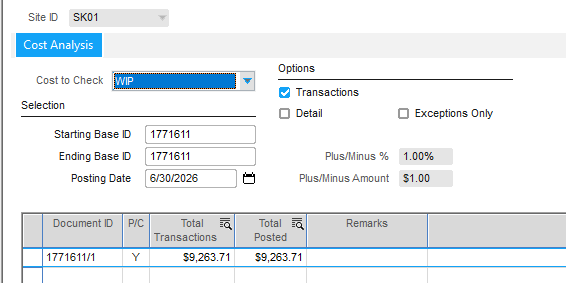

CS1802807 / KB0741317

# VMFIXWRK — Recalculating WORK_ORDER cost fields when WIP is out of balance

> **Source KB:** KB0741317 — *Costing Tools: Information about exceptions* (sections on WIP/Finished Goods exceptions and how to run `VMFIXWRK.exe`).

## Problem

Work order **1771611** showed a WIP balance that could not be reconciled through Costing Tools. A support ticket (CS1802807) had already identified the imbalance as **burden-related** before the SQL validation was run.

Confirmed burden amounts:

- Burden from `LABOR_TICKET`: **$2,845.73**
- Additional burden from issue: **$98.81**
- Standard Costing Tools recalculation options did **not** resolve the exception.

This pattern — a WIP/Finished Goods exception that persists after forcing the posting candidate and recalculating distributions — is exactly the escalation path described in **KB0741317**.

## Cost Analysis screenshots

Cost Analysis window for WO **1771611/1**, posting date **6/30/2026**, with **Exceptions Only unchecked**. Unchecking this option is required to see reclass/distribution entries that do not appear in the exception list.




## Post-VMFIXWRK reconciliation

After running `VMFIXWRK.exe` and a full costing, Cost Analysis reconciled gross-to-gross:

| Cost Analysis field | Value |
|---|---|
| Total Transactions | **$9,263.71** |
| Total Posted | **$9,263.71** |
| Variance | **$0.00** |

However, the **net WIP asset** on the work order is not the gross activity total. A manual reconciliation of the `WIP_ISSUE_DIST` rows showed:

| Account | Signed amount |
|---|---|
| `60[11-4][.1]` (WIP control / burden credit) | **($6,033.84)** |
| `163` (labor WIP / net debit) | **$9,263.71** |
| **Net WIP asset** | **$3,229.87** |

So the Cost Analysis exception was resolved because the gross activity now ties out, but the actual balance-sheet WIP remaining on the work order is the net of debits minus credits: **$9,263.71 − $6,033.84 = $3,229.87**.

## Diagnostic queries

Run these to capture the full transaction history before using VMFIXWRK:

```sql
select * from Live.dbo.inventory_trans    where workorder_base_id = '1771611';
select * from Live.dbo.wip_issue_detail   where workorder_base_id = '1771611' order by dist_no;
select * from Live.dbo.wip_issue_dist     where workorder_base_id = '1771611' order by dist_no;
select * from Live.dbo.wip_labor_detail   where workorder_base_id = '1771611' order by dist_no;
select * from Live.dbo.labor_ticket       where workorder_base_id = '1771611';
select * from Live.dbo.wip_service_detail where workorder_base_id = '1771611' order by dist_no;
select * from Live.dbo.service_receipt    where workorder_base_id = '1771611';
```

## Root cause

The `WORK_ORDER` table cost fields were out of sync with the underlying `OPERATION` and `REQUIREMENT` tables. The resulting distributions contained **reclass entries**: the full value posted to one GL account was moved to another account (visible as paired negative/positive debit-credit rows).

### Distribution timeline

- Last activity on the work order: **January 2026**.
- Last two distributions in `WIP_LABOR_DETAIL`: **dist_no 10 and 11**.
- The reclass was visible as offsetting DR/CR rows in `WIP_ISSUE_DIST`: a positive amount on one WIP account (`163`) and a negative amount on another (`604x`), indicating value was moved between accounts rather than new cost being added.

### Support engineer confirmation

> “These appear to be reclass entries. You can see the full value going to one account is being moved to another account (typically seen as a negative debit/credit with a positive debit/credit), this would indicate there is a reclass from one account to another. This will occur if a product code or G/L account was changed and the documented procedure was not followed.”

> Reference: **KB0732602** — product code / G/L account changes.

Because the reclass changed the account allocation but the `WORK_ORDER` summary cost fields were not recalculated, Costing Tools continued to report a WIP exception. Standard recalculation options do not rewrite the `WORK_ORDER` header cost fields; `VMFIXWRK.exe` does.

## Resolution

Run `VMFIXWRK.exe` to recalculate the `WORK_ORDER` cost fields.

### What VMFIXWRK does

- Recalculates requirement costs from issues.
- Recalculates operation costs from labor tickets.
- Recalculates operation costs for services.
- Writes the corrected summary back to the `WORK_ORDER` table.
- Sets `POSTING_CANDIDATE = 'Y'` on the work order so the corrected costs flow through the next costing run.

### Steps

1. Ensure **no users are logged in** to VISUAL.
2. Locate `VMFIXWRK.exe` in the VISUAL executable directory.
3. Double-click to log in.
4. Enter the specific **work order**, **engineering master**, or **quote master** to recalculate.
5. Check the **bottom 3 checkboxes**.
6. Click **Go**.
7. Run a **full costing** so the corrected costs are journalized.

> **Always run VMFIXWRK in TEST first** to review the financial impact before running it in LIVE.

## Notes on the 06/30/2026 posting date

The `POSTING_DATE = '06/30/2026'` filter in `WIP_ISSUE_DIST` returned no rows for this work order because the actual `WIP_ISSUE_DIST` postings were dated from **2025-01-31** to **2026-01-31**. In Cost Analysis, the posting date drives the *Total Posted* cutoff, not the literal date stored in the ledger distribution table.

## Related topics

- [a4.md](a4.md) — `WIP_ISSUE_DETAIL` / `INVENTORY_TRANS` relationship and distribution history.
- [a7.md](a7.md) — reconciling WIP to the ledger.
- [a902.md](a902.md) — what triggers `POSTING_CANDIDATE`.
- [KB0741317.docx](KB0741317.docx) — official KB on clearing exceptions and running `VMFIXWRK.exe`.
- [README.md](README.md) — forcing `POSTING_CANDIDATE` to N via Costing Tools.
- Job Costing Knowledge Loop: `Documentation/my-mrp-kb/Job_Costing/`


