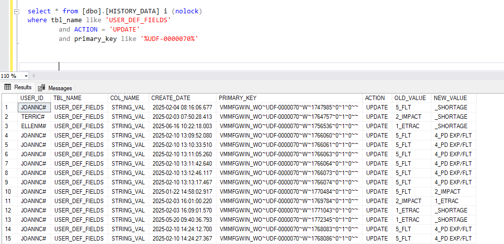

# where
``` sql
[PROGRAM_ID] = 'VMMFGWIN_WO'
          AND [LABEL] IS NULL
          AND [ID] = 'UDF-0000070'
```



## this trigger isn't working

```sql
USE [LIVE]
GO

/****** Object:  Trigger [dbo].[trg_ProtectExpedite]    Script Date: 9/21/2026 11:50:54 AM ******/
SET ANSI_NULLS ON
GO

SET QUOTED_IDENTIFIER ON
GO

-- do not edit triggers
-- please create unit test and output to csv
-- CREATE TRIGGER [dbo].[trg_ProtectExpedite]
-- ON [dbo].[USER_DEF_FIELDS]
-- AFTER UPDATE
-- AS
BEGIN
    SET NOCOUNT ON;

    -- If the current user is an authorized approver, allow the update and exit immediately
    -- Strips potential 'DOMAIN\' prefix and '#' suffix/prefix added by Visual MFG to match PERSON.ID format
    IF EXISTS (
        SELECT 1 
        FROM [dbo].[PERSON] p 
        WHERE p.ID = REPLACE(STUFF(SUSER_SNAME(), 1, CHARINDEX('\', SUSER_SNAME()), ''), '#', '')
          AND p.IS_APPROVER = 'Y'
    )
    BEGIN
        RETURN;
    END;

    -- Check if the STRING_VAL column is being updated
    IF UPDATE([STRING_VAL])
    BEGIN
        -- Revert the 'Expedite' field to its old value for unauthorized users
        -- where PROGRAM_ID = 'VMMFGWIN_WO', LABEL IS NULL, and ID = 'UDF-0000070'
        UPDATE udf
        SET udf.[STRING_VAL] = d.[STRING_VAL]
        FROM [dbo].[USER_DEF_FIELDS] udf
        INNER JOIN inserted i ON udf.[ROWID] = i.[ROWID]
        INNER JOIN deleted d ON udf.[ROWID] = d.[ROWID]
        WHERE i.[PROGRAM_ID] = 'VMMFGWIN_WO'
          AND i.[LABEL] IS NULL
          AND i.[ID] = 'UDF-0000070'
          -- Only revert if the value actually changed to avoid redundant updates
          AND (
              i.[STRING_VAL] <> d.[STRING_VAL] 
              OR (i.[STRING_VAL] IS NULL AND d.[STRING_VAL] IS NOT NULL) 
              OR (i.[STRING_VAL] IS NOT NULL AND d.[STRING_VAL] IS NULL)
          );
    END
END;


GO

-- ALTER TABLE [dbo].[USER_DEF_FIELDS] ENABLE TRIGGER [trg_ProtectExpedite]
-- GO


```