# Layer Dependencies & Import Chains

## Dependency Graph (Mermaid)

```mermaid
graph TB
    subgraph sqlmesh["Layer 1: SQLMesh Models"]
        masking_helpers["masking_helpers.py"]
        raw_udf["raw_user_def_fields.py"]
        raw_matrix["raw_matrix_driven.py"]
        raw_certified["raw_last_certified.py"]
    end

    subgraph schema["Layer 3: DDL & Schema Preparation"]
        load_erp["load_erp_ddl_into_sqlite.py"]
        gen_models["generate_matrix_models.py"]
        extract_tables["extract_tables_from_data_models.py"]
        populate_nodes["populate_schema_nodes_edges.py"]
    end

    subgraph keygen["Layer 4: Binding Key Generation"]
        key_gen["graph_key_generation.py<br/>(compile_binding_key)"]
    end

    subgraph init["Layer 5: Graph Initialization"]
        init_graph["initialize_lowercase_graph.py"]
    end

    subgraph core["Layer 2: Graph Sync Core ★ HUB"]
        graph_sync["graph_sync.py<br/>(sync_graph, get_arango_client)"]
    end

    subgraph orch["Layer 6: Orchestration"]
        incr_sync["run_incremental_graph_sync_path.py"]
        safe_rebuild["safe_arango_rebuild.py"]
        sync_edges["sync_arango_edges_with_graph.py"]
    end

    subgraph legacy["Layer 7: Legacy Migration"]
        cleanup_strat["perspective_cleanup_strategy.py"]
        legacy_plan["legacy_graph_migration_plan.py"]
        test_legacy_plan["test_legacy_graph_migration_plan_unitTest.py"]
        test_cleanup["test_perspective_cleanup_strategy_unitTest.py"]
    end

    subgraph audit["Layer 8: Audit & Validation"]
        gen_audit["generate_graph_audit.py"]
        test_contract["test_logical_sync_contract_regression_unitTest.py"]
    end

    subgraph persist["Layer 9: Persistence"]
        arangodb_shim["arangodb_persistence.py"]
    end

    subgraph utils["Layer 10: Utilities & Helpers"]
        nx_to_arango["nx_to_arango.py"]
        export_nx["export_arango_to_networkx.py"]
        clean_arango["clean_arango.py"]
        query_edges["query_arango_edges.py"]
        combined_builder["combined_graph_builder.py"]
        semantic_reason["semantic_reasoning.py"]
        solder_engine["solder_engine.py"]
    end

    subgraph e2e["Layer 11: End-to-End Testing"]
        test_e2e["test_e2e_sqlmesh_to_arango.py"]
        test_sync["test_graph_sync.py"]
        test_smoke["test_graph_sync_live_smoke.py"]
        test_ui["test_graph_sync_ui.py"]
    end

    subgraph ui["Layer 2 UI: Gradio Interface"]
        graph_sync_ui["graph_sync_ui.py"]
        app["app.py"]
    end

    %% Imports & Dependencies
    load_erp -->|reads| sqlmesh
    populate_nodes -->|reads schema_tables| load_erp
    
    graph_sync -->|uses| key_gen
    graph_sync -->|reads| schema
    
    incr_sync -->|calls| load_erp
    incr_sync -->|calls| graph_sync
    
    safe_rebuild -->|calls| graph_sync
    sync_edges -->|calls| graph_sync
    
    legacy_plan -->|imports| graph_sync
    legacy_plan -->|imports| cleanup_strat
    test_legacy_plan -->|imports| legacy_plan
    test_legacy_plan -->|imports| graph_sync
    
    test_cleanup -->|imports| cleanup_strat
    
    gen_audit -->|reads| graph_sync
    test_contract -->|imports| graph_sync
    test_contract -->|imports| key_gen
    
    graph_sync_ui -->|calls| graph_sync
    app -->|imports| graph_sync_ui
    
    test_e2e -->|imports| key_gen
    test_sync -->|imports| graph_sync
    test_smoke -->|imports| graph_sync
    test_ui -->|imports| graph_sync_ui
    
    nx_to_arango -->|uses| arangodb_shim
    export_nx -->|uses| arangodb_shim
    clean_arango -->|uses| arangodb_shim
    
    semantic_reason -->|traverses| graph_sync
    solder_engine -->|queries| graph_sync
    
    init_graph -->|creates collections| core

    style core fill:#ffcccc
    style key_gen fill:#ffffcc
    style graph_sync_ui fill:#ccffcc
```



---

## File-to-File Dependency Matrix

### Direct Import Chain: Layer 2 Hub

```python
# hf-space-inventory-sqlgen/graph_sync.py (CENTRAL HUB)
# =====================================================

# ✓ Imports FROM:
from graph_key_generation import compile_binding_key
import sqlite3
import os
import json
from arango import ArangoClient

# ✓ Exports:
GRAPH_NAME = os.environ.get("ARANGO_DB", "manufacturing_graph")
STRUCTURE_VERTEX_COLLECTION = f"{GRAPH_NAME}_node"
LOGICAL_COMPONENT_FIELD_COLLECTION = "Graph_Component_Fields"
LOGICAL_CONCEPT_COLLECTION = "Graph_Concepts"
LOGICAL_BINDING_EDGE_COLLECTION = "Column_Bindings"

def get_arango_client() -> ArangoClient:
    """Return ArangoDB client from environment config."""

def sync_graph(
    db_path: str = SQLITE_DB_PATH,
    dry_run: bool = False,
    table_filter: str = None,
    structure_only: bool = False,
) -> SyncReport:
    """Main entry point: synchronize SQLite → ArangoDB."""

def _filter_structure_data(data: List[Dict]) -> List[Dict]:
    """Internal filter for structural vertex population."""

def load_structure_sqlite_data(conn: sqlite3.Connection) -> List[Dict]:
    """Load manufacturing_graph_node vertices from SQLite."""
```

---

### Direct Imports FROM graph_sync.py

#### By Layer 2 UI (Gradio)
```python
# hf-space-inventory-sqlgen/graph_sync_ui.py
# =============================================
from graph_sync import SyncReport, sync_graph

def run_graph_sync_action(
    dry_run: bool,
    table_filter: str,
    structure_only: bool,
    sync_func: Callable[..., SyncReport] = sync_graph,  # ← INJECTED DEPENDENCY
) -> tuple[str, str]:
    report = sync_func(
        dry_run=dry_run,
        table_filter=normalized_table_filter,
        structure_only=structure_only,
    )
    return status, report.summary()
```

#### By Layer 6 Orchestration
```python
# scripts/run_incremental_graph_sync_path.py
# ============================================
sys.path.insert(0, str(HF_SPACE_DIR))
from graph_sync import _filter_structure_data, load_structure_sqlite_data, sync_graph
from load_erp_ddl_into_sqlite import parse_ddl_file

def main():
    # Parse DDL
    table_record, foreign_keys = parse_ddl_file(ddl_file)
    
    # Live sync (if enabled)
    if args.live_sync:
        sync_graph(table_filter=args.table, dry_run=False)
```

#### By Layer 6 Rebuild & Edge Management
```python
# scripts/safe_arango_rebuild.py
# ================================
from graph_sync import sync_graph, get_arango_client

# scripts/sync_arango_edges_with_graph.py
# ========================================
from graph_sync import sync_graph
```

#### By Layer 7 Legacy Migration
```python
# scripts/legacy_graph_migration_plan.py
# =======================================
import graph_sync
from perspective_cleanup_strategy import LEGACY_ASSETS

spec = {
    "expected_counts": {
        "pre_cleanup": {
            "bindings": report.vertices_synced.get("bindings", 0),
            "bound_to": report.edges_synced.get("bound_to", 0),
        }
    }
}

# scripts/test_legacy_graph_migration_plan_unitTest.py
# ====================================================
import graph_sync
import legacy_graph_migration_plan as migration_plan

def test_cleanup_spec_counts_match_graph_sync_dry_run():
    spec = migration_plan.build_cleanup_spec(REPO_ROOT)
    report = graph_sync.sync_graph(dry_run=True)
```

#### By Layer 8 Audit & Validation
```python
# scripts/test_logical_sync_contract_regression_unitTest.py
# ==========================================================
import graph_sync
from graph_key_generation import compile_binding_key

# Verify sync contract invariants
```

#### By Layer 11 Testing
```python
# hf-space-inventory-sqlgen/test_graph_sync.py
# =============================================
import graph_sync

# hf-space-inventory-sqlgen/test_graph_sync_live_smoke.py
# =======================================================
import graph_sync

# hf-space-inventory-sqlgen/test_graph_sync_ui.py
# ===============================================
import graph_sync_ui
from graph_sync_ui import run_graph_sync_action
```

---

### DDL Parsing Chain

```python
# scripts/load_erp_ddl_into_sqlite.py
# ====================================
# ✓ Exports:
def parse_ddl_file(ddl_path: Path) -> tuple[Dict, List[Dict]]:
    """
    Parse SQL Server CREATE TABLE DDL.
    Returns: (table_record, foreign_keys_list)
    """

def extract_column_definitions(body: str) -> List[Dict]:
    """Extract column metadata."""

def extract_primary_key(ddl_text: str) -> List[str]:
    """Extract PRIMARY KEY columns."""

def extract_foreign_keys(ddl_text: str) -> List[Dict]:
    """Extract FOREIGN KEY definitions."""

# ✓ Imported by:
# scripts/run_incremental_graph_sync_path.py
from load_erp_ddl_into_sqlite import parse_ddl_file

# tests/test_load_erp_ddl_into_sqlite.py
from load_erp_ddl_into_sqlite import parse_ddl_file, extract_column_definitions
```

---

### Binding Key Generation Chain

```python
# scripts/graph_key_generation.py
# ================================
# ✓ Exports:
def _normalize_fixed_token(value: str, *, field_name: str) -> str:
    """Normalize to 3-char uppercase alphanumeric."""

def _normalize_path_index(path_index: int | str) -> str:
    """Normalize to 3-digit zero-padded."""

def _normalize_perspective(perspective: str) -> str:
    """Normalize to alphanumeric + underscores."""

def compile_binding_key(
    *,
    left_source: str,
    right_target: str,
    path_index: int | str,
    intent_token: str,
    perspective: str,
) -> str:
    """Compile deterministic 5-segment binding key."""

def compile_binding_key_from_payload(payload: Mapping[str, Any]) -> str:
    """Compile key from staged payload dict."""

# ✓ Imported by:
# hf-space-inventory-sqlgen/graph_sync.py
from graph_key_generation import compile_binding_key

# scripts/test_e2e_sqlmesh_to_arango.py
from graph_key_generation import compile_binding_key

# scripts/test_logical_sync_contract_regression_unitTest.py
from graph_key_generation import compile_binding_key
```

---

### Persistence Layer Chain

```python
# arangodb_persistence.py (ROOT)
# ===============================
# ✓ Exports:
class ArangoDBConfig:
    host: str
    username: str
    password: str
    db_name: str

class ArangoDBGraphPersistence:
    def connect() -> ArangoClient
    def get_collection(name: str) -> Collection
    def insert_vertex(collection: str, doc: Dict)
    def insert_edge(collection: str, from_vertex: str, to_vertex: str)

# ✓ Imported by:
# scripts/modules/manufacturing_semantics/018_Entry_Point_*.py
# scripts/modules/manufacturing_semantics/019_Entry_Point_*.py
# scripts/modules/manufacturing_semantics/020_Entry_Point_*.py
# scripts/modules/manufacturing_semantics/026_Entry_Point_NCM2_Unit_Test.py
from arangodb_persistence import ArangoDBConfig, ArangoDBGraphPersistence

# scripts/backup_arango_graph.py
from arangodb_persistence import ArangoDBGraphPersistence
```

---

### Legacy Migration Chain

```python
# scripts/perspective_cleanup_strategy.py
# ========================================
# ✓ Exports:
@dataclass(frozen=True)
class LegacyAsset:
    name: str
    kind: str
    stage: str
    replacement: str
    rationale: str
    blockers: tuple = ()

LEGACY_ASSETS: tuple[LegacyAsset, ...] = (
    LegacyAsset(name="bindings", kind="vertex", stage="deprecate_first", ...),
    LegacyAsset(name="bound_to", kind="edge", stage="deprecate_first", ...),
    LegacyAsset(name="defined_by", kind="edge", stage="deprecate_first", ...),
    LegacyAsset(name="filters", kind="edge", stage="deprecate_first", ...),
    # ... more
)

# ✓ Imported by:
# scripts/legacy_graph_migration_plan.py
from perspective_cleanup_strategy import LEGACY_ASSETS

# scripts/test_perspective_cleanup_strategy_unitTest.py
from perspective_cleanup_strategy import LegacyAsset, LEGACY_ASSETS
```

---

### Test Import Hierarchy

```python
# Layer 11: End-to-End Tests
# ==========================

# hf-space-inventory-sqlgen/test_graph_sync.py
import sys
from pathlib import Path
sys.path.insert(0, str(HF_SPACE_DIR))
import graph_sync

# hf-space-inventory-sqlgen/test_graph_sync_live_smoke.py
import graph_sync

# hf-space-inventory-sqlgen/test_graph_sync_ui.py
import graph_sync_ui

# hf-space-inventory-sqlgen/test_app_binding_contract_surfaces.py
import graph_sync

# scripts/test_e2e_sqlmesh_to_arango.py
import duckdb
import graph_key_generation

# scripts/test_load_erp_ddl_into_sqlite.py
from load_erp_ddl_into_sqlite import parse_ddl_file

# scripts/test_logical_sync_contract_regression_unitTest.py
from graph_sync import sync_graph
from graph_key_generation import compile_binding_key

# scripts/test_legacy_graph_migration_plan_unitTest.py
import graph_sync
import legacy_graph_migration_plan

# scripts/test_perspective_cleanup_strategy_unitTest.py
from perspective_cleanup_strategy import LEGACY_ASSETS
```

---

## Dependency Resolution Order

### Initialization Sequence (First Run)

1. **Layer 5 First:** `initialize_lowercase_graph.py`
   - Creates ArangoDB database & collections
   - Establishes graph structure

2. **Layer 3 Next:** `load_erp_ddl_into_sqlite.py`
   - Parses canonical DDL from `Utilities/SQLMesh/ddl/`
   - Populates SQLite schema tracking tables

3. **Layer 2 Core:** `graph_sync.py`
   - Reads SQLite metadata
   - Connects to ArangoDB
   - Syncs vertices & edges

### Runtime Sequence (Incremental Sync)

1. **Layer 1:** SQLMesh models materialized (via `sqlmesh run`)
2. **Layer 6:** `run_incremental_graph_sync_path.py` entry point
3. **Layer 3:** `load_erp_ddl_into_sqlite.py` updates schema tracking
4. **Layer 2:** `graph_sync.py` executes sync
5. **Layer 8:** `generate_graph_audit.py` validates results

---

## Critical Import Patterns

### Pattern 1: sys.path Insertion (Python Path Management)

```python
# Most scripts add HF_SPACE_DIR to sys.path to enable graph_sync import
REPO_ROOT = Path(__file__).resolve().parent.parent
HF_SPACE_DIR = REPO_ROOT / "hf-space-inventory-sqlgen"
if str(HF_SPACE_DIR) not in sys.path:
    sys.path.insert(0, str(HF_SPACE_DIR))

from graph_sync import sync_graph
```

**Why:** `graph_sync.py` lives in `hf-space-inventory-sqlgen/`, not `scripts/`.

### Pattern 2: Circular Dependency Prevention

- `graph_sync.py` imports `graph_key_generation.py` ✓
- `graph_key_generation.py` does NOT import `graph_sync.py` ✓
- Prevents circular import issues

### Pattern 3: Dependency Injection (Testing)

```python
# graph_sync_ui.py allows injection of custom sync function
def run_graph_sync_action(
    dry_run: bool,
    table_filter: str,
    structure_only: bool,
    sync_func: Callable[..., SyncReport] = sync_graph,  # ← INJECTABLE
) -> tuple[str, str]:
    report = sync_func(...)
```

This enables unit testing without triggering actual ArangoDB operations.

---

## Summary: Dependency Tiers

| Tier | Purpose | Key Files |
|------|---------|-----------|
| **Tier 0 (Foundation)** | No deps on other layers | `graph_key_generation.py`, `perspective_cleanup_strategy.py` |
| **Tier 1 (Core Hub)** | Central sync logic | `graph_sync.py` (imports Tier 0 only) |
| **Tier 2 (Orchestration)** | Uses core hub | `run_incremental_graph_sync_path.py`, `graph_sync_ui.py` |
| **Tier 3 (Utilities)** | Optional helpers | `nx_to_arango.py`, `semantic_reasoning.py` |
| **Tier 4 (Testing)** | Integration tests | `test_*.py` files (import multiple tiers) |

---

## Next: Data Flow Pipeline

See **[02_Data_Flow_Pipeline.md](02_Data_Flow_Pipeline.md)** for end-to-end data movement with swimlanes.

