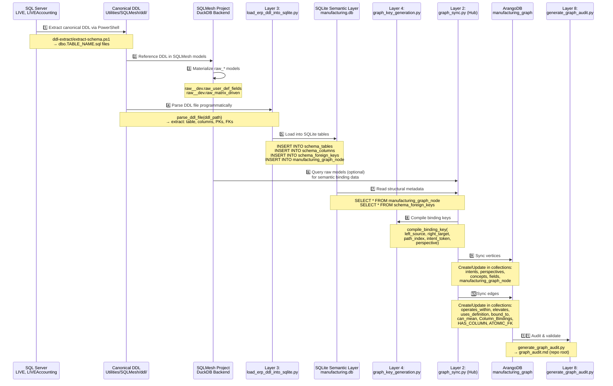

# Data Flow Pipeline: End-to-End

## Overview

The POC implements a **one-way data pipeline** from SQL Server → SQLMesh DuckDB → SQLite semantic layer → ArangoDB graph. This document traces data movement through all layers with error handling at each stage.

---

## Complete Data Flow Swimlane Diagram



---

## Stage-by-Stage Data Movement

### Stage 1: ERP DDL Extraction (Entry Point)

**Purpose:** Extract canonical CREATE TABLE DDL from SQL Server into flat files.

**Process:**
```powershell
# Documentation/Schema/ddl-extract/extract-schema.ps1
Set-Location Utilities\SQLMesh
sqlmesh lint

# For each source table, PowerShell script:
# 1. Connects to SQL Server (LIVE, LIVEAccounting)
# 2. Queries sys.objects, sys.columns, sys.foreign_keys
# 3. Generates CREATE TABLE statement
# 4. Saves to Utilities\SQLMesh\ddl\dbo.TABLE_NAME.sql
```

**Output:** Canonical DDL files
```
Utilities/SQLMesh/ddl/
  ├── dbo.WORK_ORDER.sql
  ├── dbo.OPERATION.sql
  ├── dbo.ACCOUNT.sql
  └── ... (one file per table)
```

**Error Handling:**
- Network timeout → Retry with backoff
- Permission denied → Check SQL Server login
- Invalid DDL generated → Manual review & fix

---

### Stage 2: SQLMesh Model Materialization (Optional Path)

**Purpose:** Generate semantic binding definitions from SQL Server via SQLMesh DuckDB.

**Process:**
```bash
cd Utilities/SQLMesh
sqlmesh run --select raw.raw_user_def_fields
```

**Models:**
- `raw_user_def_fields.py` — User-defined field mappings
- `raw_matrix_driven.py` — Matrix-driven binding configurations
- `raw_last_certified.py` — Last certified state tracker

**Output:** DuckDB tables in `raw__dev` or `raw__udf_isolate` schema:
```
raw__dev.raw_user_def_fields (columns: field_id, intent, perspective, left_source, right_target)
raw__dev.raw_matrix_driven (columns: matrix_id, binding_key, status)
```

**Error Handling:**
- Model compilation error → Check SQLGlot parsing
- Missing source table → Verify DDL extraction completed
- Data quality violation → Apply masking_helpers transformations

---

### Stage 3: DDL File Parsing (Layer 3 Entry)

**Purpose:** Parse canonical DDL files into structured metadata; validate SQL Server table schema.

**Process:**
```python
# scripts/load_erp_ddl_into_sqlite.py
from pathlib import Path

ddl_path = Path("Utilities/SQLMesh/ddl/dbo.WORK_ORDER.sql")
table_record, foreign_keys = parse_ddl_file(ddl_path)

# table_record = {
#     'database': 'Live',
#     'schema': 'dbo',
#     'table_name': 'WORK_ORDER',
#     'qualified_name': 'Live.dbo.WORK_ORDER',
#     'columns': [
#         {'name': 'WORKORDER_BASE_ID', 'type': 'int', 'nullable': False, 'pk': True},
#         {'name': 'DESCRIPTION', 'type': 'nvarchar', 'size': 500, 'nullable': True}
#     ],
#     'primary_keys': ['WORKORDER_BASE_ID'],
# }

# foreign_keys = [
#     {
#         'constraint_name': 'FK_WORK_ORDER_RESOURCE',
#         'src_table': 'Live.dbo.WORK_ORDER',
#         'src_columns': ['RESOURCE_ID'],
#         'ref_table': 'Live.dbo.RESOURCE',
#         'ref_columns': ['RESOURCE_ID'],
#     }
# ]
```

**Regex Patterns Used:**
```python
# Extract table header
CREATE\s+TABLE\s+\[(?P<database>[^\]]+)\]\.\[(?P<schema>[^\]]+)\]\.\[(?P<table>[^\]]+)\]

# Extract column definitions
^\[(?P<column>[^\]]+)\]\s+(?:\[(?P<type>[A-Z0-9]+)\]|(?P<plain_type>[A-Z0-9]+))(?P<size>\([^)]+\))?

# Extract PRIMARY KEY
ALTER\s+TABLE\s+.*\s+ADD\s+CONSTRAINT\s+\[(?P<constraint>[^\]]+)\]\s+PRIMARY\s+KEY

# Extract FOREIGN KEY
ALTER\s+TABLE\s+.*\s+ADD\s+CONSTRAINT\s+\[(?P<constraint>[^\]]+)\]\s+FOREIGN\s+KEY
```

**Output:** Structured dict objects (table_record, foreign_keys list)

**Error Handling:**
- File not found → Check DDL directory, run extraction script
- Regex parse failure → Log unparseable DDL, skip table
- Type mismatch → Apply data type mapping (SQL Server → SQLite compatible)

---

### Stage 4: SQLite Semantic Layer Load (Layer 3 Completion)

**Purpose:** Populate SQLite tracking database with schema & structural metadata.

**Process:**
```python
# hf-space-inventory-sqlgen/app_schema/manufacturing.db (SQLite)

# Schema setup (executed once):
CREATE TABLE schema_tables (
    source_database TEXT NOT NULL DEFAULT 'Live',
    schema_name TEXT NOT NULL DEFAULT 'dbo',
    table_name TEXT NOT NULL,
    qualified_table_name TEXT NOT NULL UNIQUE,
    ddl_file_name TEXT NOT NULL,
    collection_name TEXT NOT NULL DEFAULT 'manufacturing_graph_node',
    node_key TEXT NOT NULL UNIQUE,
    node_type TEXT NOT NULL DEFAULT 'table',
    column_count INTEGER NOT NULL DEFAULT 0,
    primary_key_count INTEGER NOT NULL DEFAULT 0,
    description TEXT,
    created_at DATETIME DEFAULT CURRENT_TIMESTAMP,
    updated_at DATETIME DEFAULT CURRENT_TIMESTAMP
);

CREATE TABLE schema_columns (
    column_id INTEGER PRIMARY KEY AUTOINCREMENT,
    table_id INTEGER NOT NULL,
    column_name TEXT NOT NULL,
    data_type TEXT NOT NULL,
    max_length INTEGER,
    precision INTEGER,
    scale INTEGER,
    is_nullable BOOLEAN DEFAULT 1,
    is_primary_key BOOLEAN DEFAULT 0,
    default_value TEXT,
    description TEXT,
    FOREIGN KEY(table_id) REFERENCES schema_tables(table_id)
);

CREATE TABLE schema_foreign_keys (
    fk_id INTEGER PRIMARY KEY AUTOINCREMENT,
    src_table_id INTEGER NOT NULL,
    ref_table_id INTEGER NOT NULL,
    constraint_name TEXT NOT NULL,
    src_columns TEXT NOT NULL,  -- JSON array
    ref_columns TEXT NOT NULL,  -- JSON array
    FOREIGN KEY(src_table_id) REFERENCES schema_tables(table_id),
    FOREIGN KEY(ref_table_id) REFERENCES schema_tables(table_id)
);

CREATE TABLE manufacturing_graph_node (
    node_key TEXT PRIMARY KEY,
    node_type TEXT NOT NULL DEFAULT 'table',
    qualified_name TEXT NOT NULL,
    database_name TEXT DEFAULT 'Live',
    schema_name TEXT DEFAULT 'dbo',
    table_name TEXT,
    description TEXT,
    collection_name TEXT DEFAULT 'manufacturing_graph_node',
    created_at DATETIME DEFAULT CURRENT_TIMESTAMP,
    updated_at DATETIME DEFAULT CURRENT_TIMESTAMP
);

# Data insertion:
INSERT INTO schema_tables (
    qualified_table_name, table_name, schema_name, source_database,
    collection_name, node_key, column_count, primary_key_count
) VALUES (
    'Live.dbo.WORK_ORDER', 'WORK_ORDER', 'dbo', 'Live',
    'manufacturing_graph_node', 'node_Live_dbo_WORK_ORDER',
    45, 4  -- (example: 45 columns, 4 PK segments)
);

INSERT INTO manufacturing_graph_node (
    node_key, qualified_name, table_name, schema_name, database_name
) VALUES (
    'node_Live_dbo_WORK_ORDER',
    'Live.dbo.WORK_ORDER',
    'WORK_ORDER',
    'dbo',
    'Live'
);
```

**Output:** SQLite rows in `schema_tables`, `schema_columns`, `schema_foreign_keys`, `manufacturing_graph_node`.

**Error Handling:**
- Constraint violation (UNIQUE) → Skip if already exists, log duplicate
- Foreign key violation → Verify referenced table was parsed first
- Data type unsupported → Map to TEXT or BLOB

---

### Stage 5: Binding Key Compilation (Layer 4)

**Purpose:** Compile deterministic, normalized binding keys for semantic edge creation.

**Process:**
```python
# scripts/graph_key_generation.py

def compile_binding_key(
    *,
    left_source: str,           # e.g., "CustomerAccount"
    right_target: str,          # e.g., "AccountReceivable"
    path_index: int | str,      # e.g., 1, 2, 3, ...
    intent_token: str,          # e.g., "Billing", "Inventory"
    perspective: str,           # e.g., "Accounts Receivable", "Operations"
) -> str:
    """
    5-Segment Formula:
    {left_segment}_{right_segment}_{path_segment}_{intent_segment}_{perspective_segment}
    
    Example:
        Input:
            left_source="Customer Account"
            right_target="Account Receivable"
            path_index=1
            intent_token="Billing"
            perspective="Accounts Receivable"
        
        Normalizations:
            left_segment = "CUS" (first 3 alphanumeric, upper)
            right_segment = "ACC" (first 3 alphanumeric, upper)
            path_segment = "001" (zero-padded)
            intent_segment = "BIL" (first 3 alphanumeric, upper)
            perspective_segment = "Accounts_Receivable" (alphanumeric + underscores)
        
        Output: "CUS_ACC_001_BIL_Accounts_Receivable"
    """
    left_segment = _normalize_fixed_token(left_source, field_name="left_source")
    right_segment = _normalize_fixed_token(right_target, field_name="right_target")
    path_segment = _normalize_path_index(path_index)
    intent_segment = _normalize_fixed_token(intent_token, field_name="intent_token")
    perspective_segment = _normalize_perspective(perspective)
    
    return f"{left_segment}_{right_segment}_{path_segment}_{intent_segment}_{perspective_segment}"
```

**Output:** Deterministic string keys used as edge identifiers in ArangoDB.

**Error Handling:**
- Insufficient alphanumeric chars → Raise ValueError, require input validation
- path_index out of range [0-999] → Raise ValueError
- perspective contains no alphanumeric → Raise ValueError

---

### Stage 6: Graph Sync Core Execution (Layer 2 Hub)

**Purpose:** Synchronize prepared metadata to ArangoDB graph.

**Process:**
```python
# hf-space-inventory-sqlgen/graph_sync.py

def sync_graph(
    db_path: str = SQLITE_DB_PATH,
    dry_run: bool = False,
    table_filter: str = None,
    structure_only: bool = False,
) -> SyncReport:
    """
    1. Connect to ArangoDB (get_arango_client)
    2. Read SQLite metadata (load_structure_sqlite_data)
    3. Optionally filter by table name
    4. Sync vertex collections:
       - Create intents, perspectives, concepts, fields
       - Create manufacturing_graph_node (structural vertices)
    5. Sync edge collections:
       - operates_within (intent → perspective)
       - elevates (intent → concept)
       - uses_definition (perspective → concept)
       - bound_to (intent → binding)
       - can_mean (field → concept)
       - Column_Bindings (logical field edges)
       - HAS_COLUMN (table → column)
       - ATOMIC_FK (table → table via FK)
    6. Return SyncReport with counts
    """
    
    client = get_arango_client()
    db = client.db(GRAPH_NAME, ...)
    
    # Read SQLite
    conn = sqlite3.connect(db_path)
    structure_data = load_structure_sqlite_data(conn)
    
    # Optional: filter
    if table_filter:
        structure_data = [
            row for row in structure_data
            if table_filter.lower() in row['qualified_name'].lower()
        ]
    
    # Dry run: count vertices/edges without writing
    if dry_run:
        return SyncReport(
            total_vertices=len(structure_data),
            total_edges=count_edges_from_structure(structure_data),
            success=True
        )
    
    # Live sync: create/update collections
    for row in structure_data:
        collection = db.collection(STRUCTURE_VERTEX_COLLECTION)
        collection.insert({
            '_key': row['node_key'],
            'qualified_name': row['qualified_name'],
            'node_type': 'table',
            'description': row.get('description', '')
        })
    
    # Sync edges
    for fk in foreign_keys:
        edge_collection = db.collection('ATOMIC_FK')
        edge_collection.insert({
            '_from': fk['src_node_key'],
            '_to': fk['ref_node_key'],
            'constraint_name': fk['constraint_name'],
            'columns': fk['column_mappings']
        })
    
    return SyncReport(success=True, ...)
```

**Output:** ArangoDB graph with populated vertices & edges.

**Error Handling:**
- ArangoDB connection failure → Retry with exponential backoff, log credentials issue
- Collection missing → Create it (via initialize_lowercase_graph.py first)
- Duplicate key → Skip or update (upsert logic in sync_graph)
- Constraint violation → Log and continue (best-effort sync)

---

### Stage 7: Audit & Validation (Layer 8)

**Purpose:** Verify sync success and document coverage.

**Process:**
```python
# scripts/generate_graph_audit.py

def main():
    # 1. Connect to manufacturing.db
    conn = sqlite3.connect(SQLITE_DB_PATH)
    
    # 2. Query schema_perspectives, schema_intents, schema_nodes
    intents = conn.execute(
        "SELECT COUNT(*) FROM schema_intents"
    ).fetchall()
    
    # 3. Connect to ArangoDB
    client = get_arango_client()
    db = client.db(GRAPH_NAME, ...)
    
    # 4. Count actual vertices/edges
    arango_intents = db.aql.execute(
        "FOR doc IN intents RETURN doc"
    ).count()
    
    # 5. Generate audit report
    coverage = {
        'schema_perspectives': schema_count,
        'arango_intents': arango_count,
        'match': schema_count == arango_count
    }
    
    # 6. Write graph_audit.md (repo root)
    # Include: coverage matrix, missing items, validation results
```

**Output:** `graph_audit.md` (repo root)

**Error Handling:**
- ArangoDB unreachable → Mark as "OFFLINE" in audit
- SQLite corrupted → Skip SQLite validation, report ArangoDB only
- Mismatch detected → List missing vertices/edges, suggest rerun

---

## Complete Data Example: WORK_ORDER Flow

```
1. SQL Server LIVE.dbo.WORK_ORDER
   ↓
2. Canonical DDL: Utilities/SQLMesh/ddl/dbo.WORK_ORDER.sql
   ├─ TABLE_NAME: WORK_ORDER
   ├─ COLUMNS: [WORKORDER_BASE_ID, DESCRIPTION, STATUS, ...]
   ├─ PRIMARY_KEYS: [WORKORDER_BASE_ID, WORKORDER_LOT_ID, WORKORDER_SPLIT_ID, WORKORDER_SUB_ID]
   └─ FOREIGN_KEYS:
       ├─ FK_WORK_ORDER_RESOURCE → Live.dbo.RESOURCE
       ├─ FK_WORK_ORDER_PART → Live.dbo.PART
       └─ FK_WORK_ORDER_LOCATION → Live.dbo.LOCATION
   ↓
3. Parsed Metadata (Python dict)
   ├─ table_record = {
   │   'qualified_table_name': 'Live.dbo.WORK_ORDER',
   │   'node_key': 'node_Live_dbo_WORK_ORDER',
   │   'columns': [...],
   │   'primary_keys': [...]
   │ }
   └─ foreign_keys = [{...}, {...}, {...}]
   ↓
4. SQLite: manufacturing.db
   ├─ schema_tables row:
   │   qualified_table_name = 'Live.dbo.WORK_ORDER'
   │   node_key = 'node_Live_dbo_WORK_ORDER'
   │   column_count = 23
   │   primary_key_count = 4
   │ 
   ├─ schema_columns rows: (23 rows)
   │   WORKORDER_BASE_ID (int, PK)
   │   WORKORDER_LOT_ID (int, PK)
   │   ...
   │ 
   ├─ schema_foreign_keys rows: (3 rows)
   │   FK to RESOURCE, FK to PART, FK to LOCATION
   │ 
   └─ manufacturing_graph_node row:
       node_key = 'node_Live_dbo_WORK_ORDER'
       qualified_name = 'Live.dbo.WORK_ORDER'
   ↓
5. Binding Keys Generated (Layer 4)
   compile_binding_key(
       left_source="WORK_ORDER",
       right_target="RESOURCE",
       path_index=1,
       intent_token="Operations",
       perspective="Work_Order_Fulfillment"
   )
   → "WOR_RES_001_OPE_Work_Order_Fulfillment"
   ↓
6. ArangoDB: manufacturing_graph
   ├─ manufacturing_graph_node collection:
   │   _key = 'node_Live_dbo_WORK_ORDER'
   │   qualified_name = 'Live.dbo.WORK_ORDER'
   │   node_type = 'table'
   │ 
   ├─ ATOMIC_FK edge collection:
   │   _from = 'node_Live_dbo_WORK_ORDER'
   │   _to = 'node_Live_dbo_RESOURCE'
   │   constraint_name = 'FK_WORK_ORDER_RESOURCE'
   │ 
   ├─ ATOMIC_FK edge collection:
   │   _from = 'node_Live_dbo_WORK_ORDER'
   │   _to = 'node_Live_dbo_PART'
   │ 
   └─ ATOMIC_FK edge collection:
       _from = 'node_Live_dbo_WORK_ORDER'
       _to = 'node_Live_dbo_LOCATION'
   ↓
7. Audit: graph_audit.md
   ✓ WORK_ORDER vertex created
   ✓ 3 ATOMIC_FK edges created
   ✓ Coverage: 1/1 tables synced
```

---

## Error Scenarios & Recovery

| Stage | Error | Recovery |
|-------|-------|----------|
| 1 (DDL Extract) | SQL Server unreachable | Retry with -UseIntegratedAuth; check VPN/firewall |
| 2 (SQLMesh) | Model compilation error | Check SQLGlot parser; fix model SQL syntax |
| 3 (DDL Parse) | Regex parse failure | Add pattern for edge case DDL syntax; log & skip |
| 4 (SQLite Load) | Constraint violation | Check for duplicates; apply upsert logic |
| 5 (Key Gen) | Invalid normalization | Validate input data quality before compilation |
| 6 (Sync) | ArangoDB offline | Retry with backoff; escalate to ops team |
| 7 (Audit) | Mismatch detected | Run sync again; verify ArangoDB integrity |

---

## Next: Binding Key Generation

See **[03_Binding_Key_Generation.md](03_Binding_Key_Generation.md)** for detailed key compilation rules.

