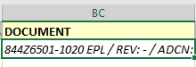

# update code for user_def_fields

use Documentation\Schema\Data_Models\Payables\06_Purchase_Order_Report_DocRef.sql and update the code,
and augment this documentation.

The previous report developer left behind very inefficient queries which would pull from
the polymorphic table named Live.dbo.USER_DEF_FIELDS for every instance.

These 'user_defined_fields pivot template queries have Case structures that behave like Pivot commnds.

Each field-set is given a program id that matches the Section and applied to the table of the ERP,
like PROGRAM_ID = 'VMPRTMNT' which is part maintenance, or 'VMVNDMNT' which is from the vendor 
maintenance section. (see Documentation\Schema\Data_Models\Payables\user_defined_fields_pivot\user_defined_fields_pivot_template_02.sql )

The following script shows how a particular program_id's data can be rotated to define the chosen
polymorphic:  See Documentation\Schema\Data_Models\Payables\user_defined_fields_pivot\UDF_Fields_SQL.sql
Each program is listed in the comments.

create udf_fields_<programID>.sql files for the program ids:

VMPRTMNT, VMVNDMNT, VMPURENT, VMMFGWIN_OP

move all table joins to USER_DEF_FIELDS to the top of the module and into pivot structures.

Try to get the lineage for the [document] field, nd note that the requestor had attached the document to the purchase
order but apparently not the work order.

## Implemented Pivot Artifacts

The purchase-order document-reference query now reads `Live.dbo.USER_DEF_FIELDS` once per
program-specific pivot CTE at the top of the module. The reusable field definitions are stored in:

- `udf_fields_VMPRTMNT.sql` - part-maintenance fields joined by part/document ID.
- `udf_fields_VMVNDMNT.sql` - vendor-maintenance fields joined by vendor ID.
- `udf_fields_VMPURENT.sql` - purchase-order header fields joined by purchase-order ID.
- `udf_fields_VMMFGWIN_OP.sql` - work-order-operation fields joined by the generated `UDF_WO` key.

Each pivot groups by `DOCUMENT_ID` and uses conditional aggregation to select the correct typed
value (`STRING_VAL` or `BOOL_VAL`) for each UDF ID. This preserves one row per source document
and prevents the repeated polymorphic-table joins from multiplying purchase-order lines.

## Document Field Lineage

The report output field `DOCUMENT` is an aggregated work-order document list. Its lineage is:

`PURCHASE_ORDER.ID` -> `DEMAND_SUPPLY_LINK.SUPPLY_BASE_ID` -> `DEMAND_SUPPLY_LINK.DEMAND_BASE_ID`
-> `WORK_ORDER.BASE_ID/LOT_ID` -> `WORK_ORDER.PART_ID` -> `DOCUMENT_REF_WO.WORKORDER_BASE_ID`
-> `DOCUMENT_REF_WO.DOCUMENT_ID` -> `DOCUMENT.ID`.

The ADCN suffix is read from the `VMDOCMNT` pivot (`UDF-0000032`) by `DOCUMENT.ID`. The main
purchase-order document path still comes from `DOCUMENT_REFERENCE` joined to the purchase-order
line's part ID. Therefore a document attached directly to the purchase order can populate
`DOCUMENT_ID` even when no matching work-order document exists; the aggregated `DOCUMENT` field
is populated only when the work-order-side `DEMAND_SUPPLY_LINK` and `DOCUMENT_REF_WO` path resolves.

### Data models Referenced for Document Field Lineage

