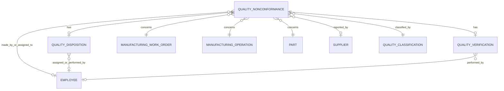

# Proposed Quality Data Model

## 1. Purpose and Scope

Define a quality-domain model that records nonconformances as information records about quality events, relates each record to the manufacturing work that it concerns, and preserves the disposition and verification evidence needed to close the case.

**Verified current state.** The target implementation is centered on `dbo.NONCONFORMANCE`. The NCM application supports entry, search, classification, disposition, verification, and corrective-action information around that record.

**Conceptual basis.** Use the IOF Core distinction between an information artifact and the real-world entities it describes. In this model, an NCM is a record about a quality event; it is not the part, work order, operation, supplier, or person involved in that event. This is a proposed modeling lens, not evidence that an IOF ontology is currently deployed.

**Sources:** [IOF Core preprint](../../../my-mrp-kb/IOF_core_paper-preprint.pdf.pdf), [legacy IQM to NCM mapping](../../../my-mrp-kb/Ops/Mapping%20%E2%80%93%20Old%20Quality%20IQM%20To%20New%20Quality%20NCM.docx), [NCM database mapping](DATABASE_MAPPING%201.md), and [NCM database integration guide](DATABASE_INTEGRATION_GUIDE%201.md).

## 2. Current-State Facts to Preserve

- `NONCONFORMANCE` is the quality-case anchor. `NCM_NUMBER` is the generated business identifier; the application also exposes an internal record identifier in search results.
- The target schema persists natural manufacturing identifiers: `PART_ID`, the work-order tuple `BASE_ID` / `LOT_ID` / `SPLIT_ID` / `SUB_ID`, and `OPERATION_ID`.
- Employee references persist badge IDs in `*_EMPLOYEE_ID` columns. Supplier reporting uses `REPORTED_BY_SUPPLIER_ID`.
- Classification is business-area aware. `TAG_AREA` identifies `MFG` or `FIN`; process, subprocess, and defect are resolved through lookup data. Their stored values are presently display names.
- The NCM form separates job/tag data, description, disposition, verification, and corrective-action information. Disposition and verification are not applicable to `Overage` NCMs.
- Legacy IQM reporting associates `VQ_NONCONFORMANCE` with `VQ_PRODUCTION_ORDER`, `VQ_OPERATION`, `VQ_PRODUCT`, employee, and disposition data. The new model must retain an explicit, lossless migration mapping for these reporting concepts.

## 3. Modeling Principles

1. **One quality-case grain:** one `QualityNonconformance` row represents one NCM business record (`NCM_NUMBER`).
2. **Separate record from subject:** retain the NCM as the system record while linking it to the relevant part, work order, operation, material lot, supplier, customer, and people.
3. **Natural-key integration:** use the target natural identifiers for operational integration; preserve legacy record IDs only as migration lineage or source-system crosswalks.
4. **Controlled classification:** represent type, status, disposition type, tag area, process, subprocess, and defect through governed lookup values rather than free text where source data permits.
5. **Lifecycle evidence:** retain dates, actors, notes, and status transitions for detection, disposition, verification, closure, and corrective action.
6. **No invented physical facts:** inspection, measurement, test-result, containment, CAPA, and attachment structures remain proposed until validated source tables and rules are available.

## 4. Core Subject Areas and Grain

### 4.1 Quality Nonconformance

**Grain:** one record per NCM business identifier.

**Verified attributes:**

- Identity: `NCM_NUMBER`, internal record identifier, NCM date, NCM type, NCM status, and closed date.
- Classification: `TAG_AREA`, process, subprocess, and defect.
- Description: specification/drawing references where present, as-is and should-be dimensions, and NCM description.
- Quantities: lot size and rejected quantity.
- Ownership: made-by employee, assigned-to employee, reporting supplier, and vendor PO number where applicable.

**Proposed relationships:**

- `QualityNonconformance` describes one or more `QualityEvent` records when a future event-level source is available.
- `QualityNonconformance` concerns zero or more `ManufacturingOperation` records and the related `ManufacturingWorkOrder` and `Part`.
- `QualityNonconformance` is classified by lookup-controlled `NcmType`, `NcmStatus`, `TagArea`, `Process`, `Subprocess`, and `Defect` values.

### 4.2 Manufacturing Context

**Grain:** one referenced operational context per NCM and work-order/operation combination.

**Verified identifiers:** `PART_ID`, `BASE_ID`, `LOT_ID`, `SPLIT_ID`, `SUB_ID`, and `OPERATION_ID`.

**Proposed bridge:** create `QualityNonconformanceManufacturingContext` only when the business permits an NCM to span multiple work orders or operations. Until then, the existing columns on `NONCONFORMANCE` define the single context.

**Manufacturing alignment:** resolve the work-order tuple and operation against the Manufacturing data model, not by reconstructing legacy warehouse `RECORD_ID` values. `OPERATION_ID` should be treated as an operation identifier within its work-order context unless the Manufacturing source confirms global uniqueness.

### 4.3 Classification and Lookup Data

**Verified current lookups:** NCM type, disposition type, employee lookup, part lookup, work-order lookup, process, subprocess, defect, and supplier lookup.

**Proposed reference entities:**

- `QualityClassification` for the MFG/FIN process-subprocess-defect hierarchy.
- `DefectDefinition` for governed defect descriptions and future photo/specification references.
- `DispositionType` and `NcmType` as explicit code sets with active/effective-date governance when the source supports it.

**Data-quality requirement:** replace display-name persistence for process, subprocess, and defect with stable lookup IDs only after a backward-compatible crosswalk and migration are approved.

### 4.4 Disposition and Corrective Action

**Grain:** one disposition section per current NCM record; a child history is proposed if multiple dispositions or revisions must be retained.

**Verified attributes:** disposition type, disposition date, closed date, assigned and acting employees, disposition-by type, rework/scrap/overage/return/accepted/rebuild quantities, notes, root cause, correction, and planning-email state.

**Proposed entities:**

- `QualityDisposition` for the accountable decision and its quantities.
- `CorrectiveAction` for root cause, correction, owner, due date, and completion evidence when actions need independent lifecycle management.
- `QualityDispositionHistory` for amendment/audit history if updates must not overwrite prior decisions.

### 4.5 Verification and Closure

**Grain:** one verification section per current NCM record; event history is proposed.

**Verified attributes:** verification date, destruction date, verification closed date, verifier employee, next step, and verification notes.

**Proposed entities:**

- `QualityVerification` for verification evidence and responsible person.
- `QualityCaseStatusHistory` for dated status transitions from open through disposition, verification, and closure.

### 4.6 Parties and Accountability

**Verified parties:** reporting supplier, made-by employee, assigned-to employee, disposition assignee, disposition actor, and verifier.

**Proposed relationship entity:** `QualityNonconformancePartyRole` with role codes. This permits multiple people or organizations per role while preserving the existing direct fields during migration.

## 5. Conceptual Relationships

The diagram is conceptual. Cardinalities beyond the verified single-record NCM sections are proposed and must be confirmed before physical schema work.

## 6. Legacy IQM to NCM Migration Outline

1. Treat legacy `VQ_NONCONFORMANCE` as a source representation, not the target model.
2. Map legacy NCM header, description, MFG/FIN process hierarchy, disposition, and verification fields to their target `NONCONFORMANCE` counterparts using the documented payload-key-to-target-column map.
3. Convert legacy product, production-order, operation, employee, and supplier record references to target natural identifiers before loading.
4. Preserve legacy `RECORD_ID` and original source field names in a migration crosswalk for traceability and report reconciliation.
5. Reconcile reporting outputs for NCM count, part, work order, operation, classification, rejected quantity, disposition quantities, status, and date ranges before retiring legacy report joins.

## 7. Reporting and Metrics Layer

Build derived quality metrics from the governed NCM model and Manufacturing context rather than embedding report-specific logic into the transactional record.

**Verified reporting dimensions:** NCM type/status, business area, process, subprocess, defect, disposition type, part, work order, operation/resource, supplier/vendor PO, employee, and NCM/disposition/verification dates.

**Candidate measures, subject to metric definitions:**

- NCM count and closure rate.
- Rejected quantity and disposition quantities by part, process, defect, supplier, and operation.
- Open NCM aging and time from NCM date to disposition, verification, and closure.
- Rework, scrap, return, rebuild, accepted, and overage quantities.
- Defect and nonconformance trends by MFG/FIN tag area.

Every metric must define its numerator, denominator, date role, exclusions (including `Overage` handling), and grain before implementation.

## 8. Governance, History, and Data Quality

- Keep `NCM_NUMBER` as the business key and retain the internal NCM record identifier as a technical key.
- Enforce the work-order tuple as an atomic composite identifier; do not join on `BASE_ID` alone.
- Validate part, work order, operation, supplier, and employee identifiers against their lookup or Manufacturing sources at write time.
- Record source system, source record ID, migration timestamp, and mapping version for migrated IQM data.
- Define controlled-value ownership and change management for NCM types, statuses, dispositions, and classification lookup values.
- Preserve audit history for material changes to status, disposition, verification, quantities, root cause, and correction when compliance or operational analysis requires it.

## 9. Open Questions Before Physical Design

1. Is `OPERATION_ID` globally unique, or must it always be paired with the work-order tuple?
2. Can one NCM legitimately apply to multiple operations, parts, lots, suppliers, or work orders?
3. What are the authoritative source tables and business rules for inspection plans, inspection executions, measurements, test results, certificates, and attachments?
4. Which lifecycle statuses and transitions are permitted for NCM, disposition, and verification records?
5. Should disposition and verification remain one-to-one sections of an NCM or become independently versioned child records?
6. What is the authoritative code/ID for process, subprocess, and defect, and how will historic display-name values be migrated?
7. What audit, retention, approval, and electronic-signature requirements govern quality records?
8. Which definitions govern yield, defect rate, scrap rate, rework rate, and closure-time metrics?

## 10. Recommended Next Deliverables

1. Validate the open questions against the NCM application schema and Manufacturing source DDL.
2. Produce a field-level legacy IQM-to-target-NCM crosswalk, including transformations and validation rules.
3. Draft a physical logical model with keys, nullability, code sets, and referential constraints.
4. Define metric contracts and reconciliation tests for legacy IQM reports versus the new NCM-backed reporting layer.