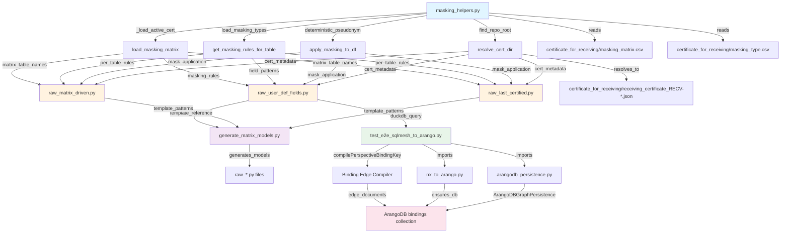

# Import & Dependency Graph: raw_user_def_fields Chain

## Overview

This document visualizes the complete 4-level import hierarchy for the masking-driven SQLMesh models and their integration with ArangoDB graph persistence. The dependency graph shows how modules cascade from atomic helpers through data models, code generation, testing, and finally to the semantic graph layer.

## 4-Level Hierarchy

```
LEVEL 0: HELPERS (Atomic Functions)
═════════════════════════════════════

  masking_helpers.py
  ├─ find_repo_root()              → Locate repository root via .git or certificate_for_receiving
  ├─ resolve_cert_dir()            → Resolve certificate_for_receiving/ path
  ├─ _load_active_cert()           → Load latest receiving_certificate_RECV-*.json
  ├─ load_masking_matrix()         → Load masking_matrix.csv as normalized DataFrame
  ├─ load_masking_types()          → Load masking_type.csv for supplementary rules
  ├─ get_masking_rules_for_table() → Match table_name patterns against masking_matrix
  ├─ deterministic_pseudonym()     → HMAC-SHA256 pseudonymization with seed
  └─ apply_masking_to_df()         → Apply mask actions (hash/redact/nullify/keep) per field


LEVEL 1: RAW MODELS (SQLMesh Python Models)
════════════════════════════════════════════

  raw_user_def_fields.py
  ├─ @model("raw.raw_user_def_fields")
  ├─ IMPORTS: all masking_helpers functions
  ├─ BEHAVIOR: Load USER_DEF_FIELDS from Staging.dbo, apply certificate metadata + masking
  ├─ RETURNS: DataFrame with columns: rowid, program_id, id, document_id, ..., cert_status, cert_version
  └─ GRAIN: [rowid]

  raw_matrix_driven.py
  ├─ @model("raw.raw_matrix_driven")
  ├─ IMPORTS: masking_helpers functions
  ├─ BEHAVIOR: Dynamically load tables per masking_matrix.csv entries, apply per-table masking
  ├─ READS: masking_matrix.csv, masking_type.csv for distinct table_name entries
  └─ RETURNS: Concatenated DataFrame from all matched tables with masking applied

  raw_last_certified.py
  ├─ @model("raw.raw_last_certified")
  ├─ IMPORTS: masking_helpers + find_repo_root, load_latest_certificate helpers
  ├─ BEHAVIOR: Load single certified table from latest receiving_certificate_RECV-*.json
  ├─ READS: certificate metadata, schema CSV, masking rules
  └─ RETURNS: Certified table DataFrame with masking applied


LEVEL 2: CODE GENERATION (Programmatic Model Factory)
═════════════════════════════════════════════════════════

  generate_matrix_models.py
  ├─ read_masking_matrix(Path)   → Extract distinct table_name entries from masking_matrix.csv
  ├─ read_schema_csv(Path)       → Load schema documentation CSV (table → columns mapping)
  ├─ TYPE_MAP: SQL types → SQLMesh types (int, text, double, timestamp)
  ├─ sanitize_name(str)          → Normalize table names for Python file naming
  ├─ MODEL_TEMPLATE: Jinja template for raw_*.py file generation
  └─ OUTPUT: Generates raw_<table_name>.py for each distinct table_name in masking_matrix.csv
             (reads template from raw_user_def_fields as reference)


LEVEL 3: INTEGRATION & TESTING (E2E Pipeline)
══════════════════════════════════════════════

  test_e2e_sqlmesh_to_arango.py
  ├─ IMPORTS: compilePerspectiveBindingKey() local function
  ├─ DEPENDS_ON: masking_helpers, nx_to_arango, arangodb_persistence
  ├─ WORKFLOW:
  │   1. Query DuckDB: SELECT program_id, id, data_type, label FROM raw__dev.raw_user_def_fields
  │   2. Extract semantic bindings: user_def_fields → concept aliases
  │   3. Compile deterministic edge keys: {typeSelection}::{sourceEntity}_to_{targetEntity}::seq_{seq}::{category}
  │   4. Create ArangoDB edge documents in 'bindings' collection
  │   5. Graph structure: field_components/user_def_fields → concepts/{concept_alias}
  └─ RETURNS: None (side-effect: ArangoDB document insertion)

  nx_to_arango.py
  ├─ load_dotenv_locations()      → Load .env from CWD, repo-root, or scripts/
  ├─ ensure_db_and_user()         → Create ArangoDB database and dev user
  ├─ CREATE COLLECTIONS: tables (vertex), reports (vertex), dependencies (edge), edges (edge)
  └─ WRITES: NetworkX graph nodes/edges to ArangoDB collections

  arangodb_persistence.py (shim)
  ├─ LOCATION: Utilities/SQLMesh/Semantic/Elevations/arangodb_persistence.py (real implementation)
  ├─ EXPORTS: ArangoDBConfig, ArangoDBGraphPersistence classes
  ├─ PURPOSE: Repository-level import shim for legacy backward compatibility
  └─ USAGE: from arangodb_persistence import ArangoDBConfig, ArangoDBGraphPersistence


LEVEL 4: CERTIFICATION & PERSISTENCE (Metadata Drivers)
═══════════════════════════════════════════════════════

  certificate_for_receiving/
  ├─ receiving_certificate_RECV-*.json  → Latest certified receiving agreement
  ├─ masking_matrix.csv                 → Table → Field → Mask Action mapping
  └─ masking_type.csv                   → (Optional) Supplementary masking rule definitions
```

---

## Complete Dependency Graph (Mermaid DAG)



---

## Import Chain Cross-References

### Level 0 → Level 1 Dependencies

| Helper Function | Raw Model | Usage |
|---|---|---|
| `find_repo_root()` | All models | Locate certificate_for_receiving directory |
| `resolve_cert_dir()` | All models | Resolve absolute path to certificate_for_receiving/ |
| `_load_active_cert()` | All models | Load latest receiving_certificate_RECV-*.json, validate status='certified' |
| `load_masking_matrix()` | raw_matrix_driven, raw_last_certified | Load CSV masking rules |
| `load_masking_types()` | raw_matrix_driven, raw_last_certified | Load supplementary masking types |
| `get_masking_rules_for_table()` | All models | Match table_name patterns (fnmatch) against masking_matrix rows |
| `deterministic_pseudonym()` | apply_masking_to_df (via) | HMAC-SHA256 pseudonymization using RECEIVING_PSEED |
| `apply_masking_to_df()` | All models | Apply mask actions to DataFrame columns |

### Level 1 → Level 2 Dependencies

| Raw Model | generate_matrix_models.py | Usage |
|---|---|---|
| raw_user_def_fields.py | Template reference | MODEL_TEMPLATE uses this as structural blueprint |
| raw_matrix_driven.py | Schema inference | Patterns for dynamic column discovery |
| raw_last_certified.py | Certification patterns | Patterns for certificate-driven column sets |

### Level 2 → Level 3 Dependencies

| Code Generator | Test/Integration | Usage |
|---|---|---|
| generate_matrix_models.py | test_e2e_sqlmesh_to_arango.py | Generated raw_*.py models are targets for DuckDB materialization |
| raw_user_def_fields.py | test_e2e_sqlmesh_to_arango.py | Primary source query: SELECT program_id, id, data_type, label FROM raw_user_def_fields |

### Level 3 → Level 4 Dependencies

| Integration Script | Certification Artifact | Usage |
|---|---|---|
| test_e2e_sqlmesh_to_arango.py | masking_matrix.csv | Extract semantic bindings; determine field masking policies |
| test_e2e_sqlmesh_to_arango.py | receiving_certificate_RECV-*.json | Validate certificate status, extract receiving metadata |
| nx_to_arango.py | (implicit) | Ensure ArangoDB database and collections exist |
| arangodb_persistence.py | (implicit) | Provide ArangoDBGraphPersistence class for document insertion |

---

## Circular Dependency Prevention

The hierarchy is strictly acyclic by design:

- **Level 0** (masking_helpers) has no imports from other levels → ✅ Base foundation
- **Level 1** (raw models) only imports from Level 0 → ✅ No upward imports
- **Level 2** (code generation) only reads Level 1 as template reference (no execution import) → ✅ Safe for codegen
- **Level 3** (integration) imports from Level 0, 2, 4 but not 1 directly → ✅ Deferred execution via DuckDB
- **Level 4** (certificates) are data, not code → ✅ No imports

---

## SQLMesh Serialization Constraints

⚠️ **Important**: SQLMesh models must be serializable to YAML for scheduling.

### Constraint: No Module Aliases in Level 1 Models

```python
# ❌ WRONG (fails SQLMesh serialization)
from Utilities.SQLMesh.models.raw import masking_helpers as helper
apply_masking_to_df = helper.apply_masking_to_df  # indirect ref

# ✅ CORRECT (direct imports work)
from Utilities.SQLMesh.models.raw.masking_helpers import apply_masking_to_df
```

All Level 1 models use direct imports from masking_helpers to ensure SQLMesh can serialize the model function signatures.

---

## References

- [Development Path Lineage](01_Development_Path_Lineage.md)
- [Masking Matrix Schema](02_Masking_Matrix_Schema.md)
- [ArangoDB Binding Format](03_ArangoDB_Binding_Format.md)
- [Model Generation Workflow](04_Model_Generation_Workflow.md)
