# Development Path: Certificate → Masking → DataFrame → DuckDB → ArangoDB

## Overview

This document traces the **complete end-to-end flow** from certificate discovery through masking application, SQLMesh materialization, DuckDB persistence, and finally ArangoDB graph semantic binding. Each step is illustrated with actual code examples and decision points.

---

## Flow Diagram

```mermaid
flowchart LR
    subgraph discovery["🔍 Discovery Phase"]
        A["find_repo_root<br/>certificate_for_receiving/"]
        B["resolve_cert_dir<br/>Path resolution"]
        C["_load_active_cert<br/>RECV-*.json latest"]
    end
    
    subgraph validation["✓ Validation Phase"]
        D["cert.status<br/>== 'certified'"]
        E["load_masking_matrix<br/>masking_matrix.csv"]
        F["get_masking_rules<br/>per table_name"]
    end
    
    subgraph loading["📥 Data Loading Phase"]
        G["pyodbc.connect<br/>Staging.dbo"]
        H["pd.read_sql<br/>SELECT * FROM TABLE"]
        I["df.columns<br/>normalize lowercase"]
    end
    
    subgraph masking["🔐 Masking Phase"]
        J["apply_masking_to_df<br/>per field rules"]
        K["deterministic_pseudonym<br/>HMAC-SHA256"]
        L["redact/nullify/keep<br/>per mask_action"]
    end
    
    subgraph enrichment["📦 Enrichment Phase"]
        M["df.assign<br/>receiving_id<br/>receiver_id<br/>cert_status<br/>cert_version"]
    end
    
    subgraph sqlmesh["⚙️ SQLMesh Phase"]
        N["@model execute<br/>return df"]
        O["SQLMesh infers columns<br/>grain=[rowid]"]
        P["Materialization:<br/>raw__dev or raw__udf_isolate"]
    end
    
    subgraph duckdb["🗄️ DuckDB Phase"]
        Q["SELECT program_id, id,<br/>data_type, label<br/>FROM raw_user_def_fields"]
        R["Extract semantic<br/>bindings"]
    end
    
    subgraph arango["🔗 ArangoDB Phase"]
        S["compilePerspectiveBindingKey<br/>Generate edge key"]
        T["Create edge document:<br/>_from/_to/metadata"]
        U["Insert into bindings<br/>collection"]
    end
    
    A --> B --> C --> D
    D -->|status==certified| E
    E --> F
    F --> G --> H --> I
    I --> J --> K
    J --> L
    L --> M
    M --> N --> O --> P
    P --> Q --> R
    R --> S --> T --> U
    
    style discovery fill:#e3f2fd
    style validation fill:#f3e5f5
    style loading fill:#fff3e0
    style masking fill:#ffe0b2
    style enrichment fill:#f1f8e9
    style sqlmesh fill:#e0f2f1
    style duckdb fill:#eceff1
    style arango fill:#fce4ec
```



---

## Phase 1: Discovery (Certificate Location)

### Code: `masking_helpers.find_repo_root()`

```python
def find_repo_root(start: Path) -> Path:
    cur = start.resolve()
    for p in [cur] + list(cur.parents):
        if (p / "certificate_for_receiving").exists() or (p / ".git").exists():
            return p
    raise FileNotFoundError("Repository root with certificate_for_receiving not found")
```

**Purpose**: Locate the absolute repository root by traversing up from the module file location until finding either `certificate_for_receiving/` or `.git/`.

**When called**:
- During model initialization in raw_user_def_fields.py
- Every model execution to ensure certificate_for_receiving/ is discoverable

**Input**: `Path(__file__)` from masking_helpers.py location
**Output**: Absolute Path to repository root
**Failure mode**: Raises FileNotFoundError if neither certificate_for_receiving/ nor .git/ found

### Code: `masking_helpers.resolve_cert_dir()`

```python
def resolve_cert_dir() -> Path:
    return find_repo_root(Path(__file__)).joinpath("certificate_for_receiving").resolve()
```

**Purpose**: Get the absolute path to certificate_for_receiving/ directory.

**Returns**: Absolute Path like `/c/Users/williamt/source/skillsinc/skills-inc-org/SQL-Projects/certificate_for_receiving`

---

## Phase 2: Validation (Certificate Loading)

### Code: `masking_helpers._load_active_cert()`

```python
def _load_active_cert() -> dict:
    cert_dir = resolve_cert_dir()
    candidates = sorted(cert_dir.glob("receiving_certificate_RECV-*.json"))
    if not candidates:
        raise FileNotFoundError("No receiving certificates found in certificate_for_receiving/")
    cert_path = candidates[-1]
    with cert_path.open(encoding="utf-8") as f:
        cert = json.load(f)
    if cert.get("status") != "certified":
        raise ValueError(f"Certificate {cert_path.name} status is '{cert.get('status')}', expected 'certified'.")
    return cert
```

**Purpose**: Load the latest (lexicographically sorted) receiving_certificate_RECV-*.json file and validate its status.

**Key steps**:
1. Glob certificate_for_receiving/ for `receiving_certificate_RECV-*.json` files
2. Select the last one (sorted alphabetically) as the "active" certificate
3. Parse JSON
4. **Validate**: Check that `cert["status"] == "certified"` (reject drafts)
5. Raise ValueError if not certified

**Example cert structure**:
```json
{
  "receiving_id": "RECV-2025-12-30-001",
  "certificate_version": "1.0",
  "status": "certified",
  "masking_matrix_ref": {
    "dag_lines": [
      {"table_name": "USER_DEF_FIELDS", "required": true},
      {"table_name": "OPERATION", "required": false}
    ]
  }
}
```

---

## Phase 3: Matrix Loading (Masking Rules Discovery)

### Code: `masking_helpers.load_masking_matrix()`

```python
def load_masking_matrix(path: Path) -> pd.DataFrame:
    if not path.exists():
        raise FileNotFoundError(path)
    df = pd.read_csv(path, dtype=str).fillna("")
    df.columns = [c.strip().lower() for c in df.columns]
    return df
```

**Purpose**: Load masking_matrix.csv and normalize column names to lowercase.

**Input**: Path to masking_matrix.csv (typically: `certificate_for_receiving/masking_matrix.csv`)
**Output**: DataFrame with columns normalized to lowercase

**Expected CSV columns**:
- `table_name` (required) - pattern for table matching (supports fnmatch wildcards)
- `column_name` / `field_name` / `column` (required) - field to apply masking
- `masking_type` / `mask_action` / `masking_rule` (required) - action to apply

**Example masking_matrix.csv**:
```csv
table_name,column_name,masking_type
USER_DEF_FIELDS,string_val,pseudonymize
USER_DEF_FIELDS,number_val,keep
OPERATION,employee_id,pseudonymize
OPERATION,*,redact
```

---

## Phase 4: Rule Extraction (Per-Table Matching)

### Code: `masking_helpers.get_masking_rules_for_table()`

```python
def get_masking_rules_for_table(table_name: str, mask_df: pd.DataFrame, types_df: pd.DataFrame) -> list[dict]:
    rules = []
    tn = table_name.lower()
    for _, row in mask_df.iterrows():
        pattern = str(row.get("table_name", "")).strip().lower()
        if not pattern:
            continue
        if fnmatch.fnmatch(tn, pattern):  # Pattern matching support
            field = row.get("column_name") or row.get("field_name") or row.get("column") or ""
            mask_action = row.get("masking_type") or row.get("mask_action") or row.get("masking_rule") or ""
            rules.append({
                "field_name": str(field).strip().lower(),
                "mask_action": str(mask_action).strip().lower()
            })
    return rules
```

**Purpose**: Extract masking rules for a specific table using fnmatch pattern matching.

**Example**:
```python
mask_df = load_masking_matrix(Path("certificate_for_receiving/masking_matrix.csv"))
rules = get_masking_rules_for_table("user_def_fields", mask_df, pd.DataFrame())
# Returns:
# [
#   {"field_name": "string_val", "mask_action": "pseudonymize"},
#   {"field_name": "number_val", "mask_action": "keep"}
# ]
```

---

## Phase 5: Data Loading (ODBC → Pandas)

### Code: `raw_user_def_fields.py` (partial)

```python
_CONNECTION_STRING = os.environ.get(
    "STAGING_ODBC", 
    "Driver={ODBC Driver 18 for SQL Server};Server=sql-lab-2;Database=Staging;Trusted_Connection=yes;..."
)

_SELECT_SQL = """
SELECT
    ROWID     AS rowid,
    PROGRAM_ID     AS program_id,
    ID     AS id,
    ... (18 more columns)
FROM Staging.dbo.USER_DEF_FIELDS WITH (NOLOCK)
"""

@model("raw.raw_user_def_fields", kind="FULL", ...)
def execute(context: ExecutionContext, **kwargs: t.Any) -> pd.DataFrame:
    pyodbc = importlib.import_module("pyodbc")
    conn = pyodbc.connect(_CONNECTION_STRING)
    df = pd.read_sql(_SELECT_SQL, conn)
    df.columns = [c.lower() for c in df.columns]
    return df
```

**Purpose**: Execute SQL query via ODBC and load result into pandas DataFrame.

**Connection**: Uses STAGING_ODBC environment variable or defaults to sql-lab-2
**Query**: Selects 20 columns from Staging.dbo.USER_DEF_FIELDS with column aliases (AS)
**Normalization**: Convert all column names to lowercase for case-insensitive masking matching

---

## Phase 6: Masking Application (Field-Level Transformations)

### Code: `masking_helpers.apply_masking_to_df()`

```python
def apply_masking_to_df(df: pd.DataFrame, rules: list[dict], seed: str | None):
    for rule in rules:
        field = rule.get("field_name")
        action = (rule.get("mask_action") or "").lower()
        if not field or field not in df.columns:
            continue
        if action in ("deterministic_hash", "hash_sha256", "pseudonymize", "pseudo", "hmac"):
            if not seed:
                raise ValueError("Masking policy requires RECEIVING_PSEED for pseudonymize action")
            df[field] = df[field].apply(lambda v: deterministic_pseudonym(v, seed, field))
        elif action in ("redact", "mask"):
            df[field] = "<REDACTED>"
        elif action in ("nullify", "null"):
            df[field] = None
        elif action in ("keep", "none", "passthrough"):
            continue
        else:
            logging.warning("Unknown mask action '%s' for field '%s'", action, field)
```

**Purpose**: Transform DataFrame columns based on masking rules.

**Actions supported**:
- **pseudonymize** / **hash_sha256** / **hmac**: Call deterministic_pseudonym() with RECEIVING_PSEED
- **redact** / **mask**: Replace with "<REDACTED>"
- **nullify** / **null**: Replace with None
- **keep** / **none** / **passthrough**: Leave unchanged

**Example**:
```python
df = pd.DataFrame({
    "string_val": ["Alice", "Bob", "Charlie"],
    "number_val": [100, 200, 300]
})

rules = [
    {"field_name": "string_val", "mask_action": "pseudonymize"},
    {"field_name": "number_val", "mask_action": "keep"}
]

seed = os.environ["RECEIVING_PSEED"]
apply_masking_to_df(df, rules, seed)

# Result:
#         string_val  number_val
# 0  f3e4d2a1c9...         100
# 1  7b2e9c5a3f...         200
# 2  a8c2e1d4f9...         300
```

### Code: `masking_helpers.deterministic_pseudonym()`

```python
def deterministic_pseudonym(value: t.Any, seed: str, field_name: str = "") -> t.Optional[str]:
    if value is None or seed is None:
        return None
    v = str(value)
    return hmac.new(seed.encode("utf-8"), f"{field_name}:{v}".encode("utf-8"), hashlib.sha256).hexdigest()
```

**Purpose**: Generate reproducible HMAC-SHA256 pseudonym from value using external seed.

**Determinism**: Same value + same seed + same field_name always produces identical hash
**Usage**: Enables consistent entity linking across multiple masking passes

**Example**:
```python
seed = "my-enterprise-key"
result = deterministic_pseudonym("Alice", seed, "string_val")
# Returns: "f3e4d2a1c96b2e5c8a1b3d4e7f9a2c5" (same result every time)
```

---

## Phase 7: Certificate Enrichment

### Code: `raw_user_def_fields.py` (final section)

```python
# Extract scalar values outside the DataFrame
r_id = str(cert.get("receiving_id", "")) if cert else ""
rec_id = r_id.replace("RECV-", "RECR-", 1) if r_id else None
c_status = str(cert.get("status", "")) if cert else ""
c_ver = str(cert.get("certificate_version", "")) if cert else ""

# ⚡ FIX: assign in one clean operation
df = df.assign(
    receiving_id=r_id,
    receiver_id=rec_id,
    cert_status=c_status,
    cert_version=c_ver,
)

return df
```

**Purpose**: Add certificate metadata columns to DataFrame.

**New columns**:
- `receiving_id`: e.g., "RECV-2025-12-30-001"
- `receiver_id`: Transformed from receiving_id (RECV- → RECR-)
- `cert_status`: Certificate status, should be "certified"
- `cert_version`: Certificate version e.g., "1.0"

**Result**: DataFrame now includes both data and provenance metadata

---

## Phase 8: SQLMesh Materialization

### SQLMesh Execution Context

```python
@model(
    "raw.raw_user_def_fields",
    kind="FULL",
    columns={...},
    grain=["rowid"],
    description="Auto-generated model for user_def_fields; masking driven by masking_matrix.csv"
)
def execute(context: ExecutionContext, **kwargs: t.Any) -> pd.DataFrame:
    # ... (phases 1-7 above)
    return df
```

**Model configuration**:
- **kind**: "FULL" (full refresh, not incremental)
- **grain**: ["rowid"] (unique key per row)
- **columns**: 23 columns defined (rowid, program_id, id, ..., cert_version)

**SQLMesh behavior**:
1. Calls execute() function
2. Returns DataFrame
3. **Infers column names and types** from DataFrame dtypes
4. Materializes to DuckDB using default naming: `raw__dev.raw_user_def_fields` or `raw__udf_isolate.raw_user_def_fields` (depending on schema isolation setting)

---

## Phase 9: DuckDB Persistence & Querying

### Code: `test_e2e_sqlmesh_to_arango.py` (query phase)

```python
duckdb_path = str(root_path / "Utilities" / "SQLMesh" / "db.db")
duck_conn = duckdb.connect(duckdb_path)

try:
    query = """
        SELECT DISTINCT program_id, id, data_type, label 
        FROM raw__dev.raw_user_def_fields 
        WHERE document_id IS NULL AND LOWER(program_id) = 'vmprtmnt'
    """
    print("🛰️ Attempting to harvest SCD headers from raw__dev schema...", flush=True)
    scd_definitions = duck_conn.execute(query).fetchall()
except duckdb.CatalogException:
    query = """
        SELECT DISTINCT program_id, id, data_type, label 
        FROM raw__udf_isolate.raw_user_def_fields 
        WHERE document_id IS NULL AND LOWER(program_id) = 'vmprtmnt'
    """
    print("🛰️ Falling back to harvest SCD headers from raw__udf_isolate schema...", flush=True)
    scd_definitions = duck_conn.execute(query).fetchall()

total_records = len(scd_definitions)
print(f"📥 Successfully retrieved {total_records} SCD schema definitions from DuckDB.", flush=True)
```

**Purpose**: Query DuckDB materialized tables to extract semantic bindings.

**Query logic**:
1. Try schema: `raw__dev.raw_user_def_fields` (dev schema, typically)
2. Fallback to: `raw__udf_isolate.raw_user_def_fields` (isolated schema, for test)
3. Filter: `document_id IS NULL` (top-level SCD header rows only, not line items)
4. Filter: `LOWER(program_id) = 'vmprtmnt'` (specific program focus)

**Result**: List of tuples: `(program_id, udf_id, data_type, label)`

---

## Phase 10: ArangoDB Binding Generation

### Code: `test_e2e_sqlmesh_to_arango.py` (binding compilation)

```python
type_map = {1: "boolean", 3: "numeric", 5: "string", 1005: "list"}
col_map = {1: "bool_val", 3: "number_val", 5: "string_val", 1005: "string_val"}

inserted_count = 0
for prog_id, udf_id, data_type, label in scd_definitions:
    poly_type = type_map.get(data_type, "string")
    source_col = col_map.get(data_type, "string_val")
    
    concept_alias = label.lower().replace(" (sq in)", "").replace(":", "").replace(" ", "_").strip()
    concept_alias = re.sub(r'[^a-z0-9_]', '', concept_alias)

    compiled_key = compilePerspectiveBindingKey({
        "typeSelection": "User_Def_Fields",
        "sourceEntity": "user_def_fields",
        "targetEntity": concept_alias,
        "sequenceNumber": int(udf_id.split("-")[-1]) if '-' in udf_id else 0,
        "categorySlug": "engineering"
    })

    edge_data = {
        "_key": compiled_key,
        "_from": "field_components/user_def_fields",
        "_to": f"concepts/{concept_alias}",
        "binding_key": compiled_key,
        "perspective": "engineering",
        "category": "engineering",
        "logic_type": "conditional_case",
        "program_id": prog_id.lower(),
        "udf_id": udf_id.lower(),
        "friendly_label": label,
        "poly_type": poly_type,
        "aliased_to": concept_alias,
        "source_value_column": source_col
    }

    db.collection("bindings").insert(edge_data)
    inserted_count += 1
```

**Purpose**: Create semantic graph edge documents for ArangoDB.

**Key transformations**:
1. **Type mapping**: data_type (integer code) → poly_type (string)
2. **Column mapping**: data_type → source_col (which value column: bool_val, number_val, string_val)
3. **Alias generation**: label (with cleanup) → concept_alias
4. **Key compilation**: Dictionary → deterministic compiled_key via compilePerspectiveBindingKey()

**Result**: Edge document inserted into ArangoDB 'bindings' collection

---

## Phase 11: Binding Key Compilation

### Code: `compilePerspectiveBindingKey()` (from test_e2e_sqlmesh_to_arango.py)

```python
def compilePerspectiveBindingKey(binding_meta: dict) -> str:
    """
    Generates a deterministic unique graph edge key for the semantic layer,
    formatting it purely lowercase to enforce consistent graph matching rules.
    """
    type_sel = binding_meta.get("typeSelection", "udf").lower()
    source = binding_meta.get("sourceEntity", "unknown").lower()
    target = binding_meta.get("targetEntity", "unknown").lower()
    seq = binding_meta.get("sequenceNumber", 0)
    cat = binding_meta.get("categorySlug", "general").lower()
    
    # Generate a reproducible, clean alphanumeric binding key string
    raw_key = f"{type_sel}::{source}_to_{target}::seq_{seq}::{cat}"
    clean_key = re.sub(r'[^a-z0-9_:]', '', raw_key.replace(" ", "_"))
    return clean_key
```

**Purpose**: Generate deterministic edge key for ArangoDB binding.

**Format**: `{typeSelection}::{sourceEntity}_to_{targetEntity}::seq_{sequenceNumber}::{categorySlug}`

**Example**:
```python
key = compilePerspectiveBindingKey({
    "typeSelection": "User_Def_Fields",
    "sourceEntity": "user_def_fields",
    "targetEntity": "part_number",
    "sequenceNumber": 42,
    "categorySlug": "engineering"
})
# Result: "user_def_fields::user_def_fields_to_part_number::seq_42::engineering"
```

---

## Phase 12: ArangoDB Insertion

### ArangoDB Collection Structure

**Collection**: `bindings` (edge collection)

**Edge document example**:
```json
{
  "_key": "user_def_fields::user_def_fields_to_part_number::seq_42::engineering",
  "_from": "field_components/user_def_fields",
  "_to": "concepts/part_number",
  "binding_key": "user_def_fields::user_def_fields_to_part_number::seq_42::engineering",
  "perspective": "engineering",
  "category": "engineering",
  "logic_type": "conditional_case",
  "program_id": "vmprtmnt",
  "udf_id": "udf-42",
  "friendly_label": "Part Number",
  "poly_type": "string",
  "aliased_to": "part_number",
  "source_value_column": "string_val"
}
```

**Graph structure**:
```
vertex: field_components/user_def_fields
  ├─ edge→concept: user_def_fields_to_part_number
  ├─ edge→concept: user_def_fields_to_description
  └─ edge→concept: user_def_fields_to_quantity
```

---

## Error Handling & Fallback Strategy

### Certificate Not Found
```python
# Catch: FileNotFoundError
# Action: Log and terminate (no cert = no masking authority)
```

### Certificate Not Certified
```python
# Catch: ValueError (status != 'certified')
# Action: Reject the certificate, wait for certified version
```

### DuckDB Schema Mismatch
```python
# Catch: duckdb.CatalogException
# Action: Try fallback schema (raw__dev → raw__udf_isolate)
```

### ArangoDB Connection Failure
```python
# Catch: arango.exceptions.ConnectionFailure
# Action: Log, escalate, do not persist incomplete graph
```

---

## References

- [Import Dependency Graph](00_Import_Dependency_Graph.md)
- [Masking Matrix Schema](02_Masking_Matrix_Schema.md)
- [ArangoDB Binding Format](03_ArangoDB_Binding_Format.md)
