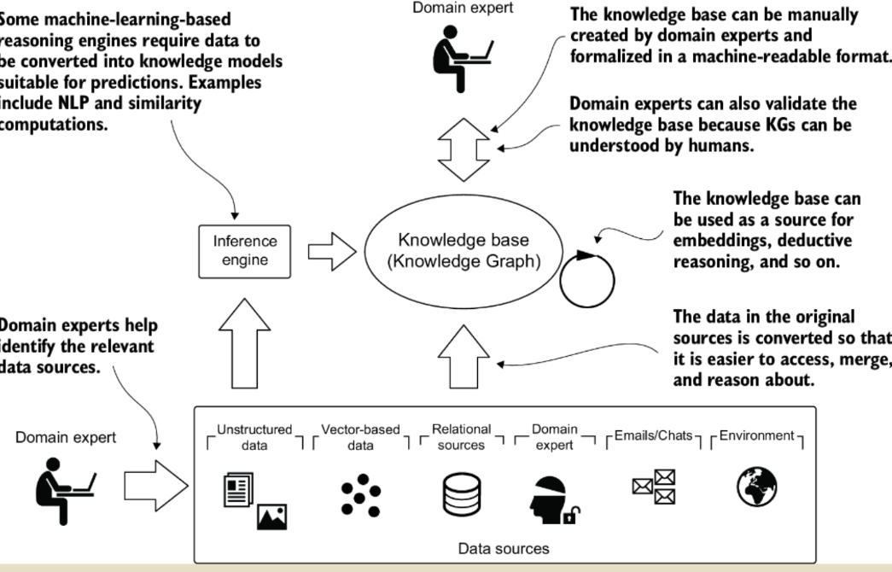
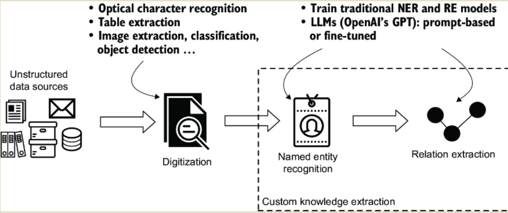

The Rockefeller Foundation’s process of selecting projects for funding relied on program officers who pinpointed areas of research worthy of grants. These officers developed deep knowledge about their specializations by building networks of researchers as well as searching for recommendations outside of those networks. They wrote notes about meetings, phone calls, and dinners in their diaries, often hastily and on typewriters, using shortcuts, abbreviations, and domain-specific nomenclature. These diaries represent a treasure trove of detailed knowledge as well as professional and personal observations. If mined and modeled properly, we could use this information to answer questions like these: Are there any patterns that typically precede the funding of an idea?  Do granted projects tend to follow recommendations from influential scientists or previous grantees?  How many internal discussions take place before a grant is awarded?  Are there trends in funding subdisciplines? Do they change over time?  This chapter showcases how we can adjust state-of-the-art ML technologies to a specific domain and mine complex knowledge from unstructured data. In the following chapter, we use this extracted information to produce a KG and answer complex questions about relational information previously locked in unstructured documents.