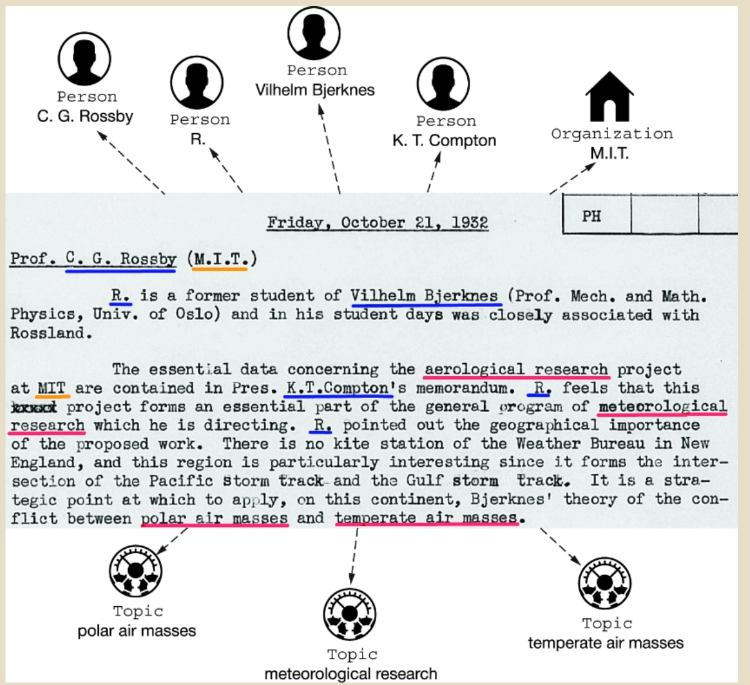

Many open source NLP libraries offer models with generic entity categories (Person, Location, Organization, and so on) out of the box. However, these are rarely enough. For example, figure 5.2 shows an entry from the diary of Rockefeller Foundation program officer Warren Weaver. In this case, identifying mentions of people and organizations is important, but just as important is recognizing conversation topics. Further, a Topic entity can be one of three subtypes: a research discipline, a technology, or a disease.

chapters/ch05/readch5-001.md
/home/clovi/projects/knowledge-graphs-and-llms-in-action/chapters/ch05/readch5-002.md