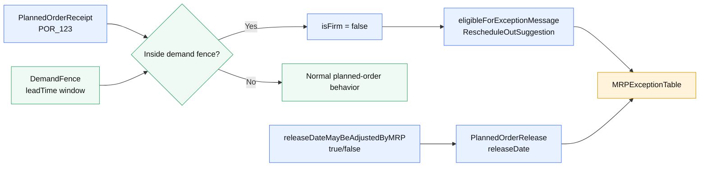

# POR → eligibility → MRP exception table

This diagram models the descriptive semantics: a PlannedOrderReceipt inside the demand fence is not treated as a firm order, but is eligible for exception reasoning. The operational MRP engine decides whether to generate a message and whether to adjust the release date.

## Semantics

- `PlannedOrderReceipt` can be inside a `DemandFence` without being firm.
- If inside the demand fence, it is eligible for a `RescheduleOutSuggestion` via `eligibleForExceptionMessage`.
- The `MRPExceptionTable` is the operational tracking surface; the ontology only describes eligibility, not mandatory generation.
- `releaseDateMayBeAdjustedByMRP` indicates mutability without enforcing a change.
